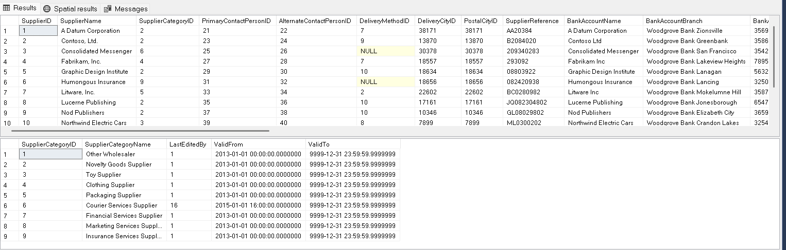

<h1>Identificación de entidades, relaciones y datos disponibles</h1>

## 1. De las preguntas de negocio al descubrimiento de datos

Antes de diseñar dashboards o desarrollar soluciones de Business Intelligence (BI), considero fundamental comprender qué preguntas de negocio necesito responder y qué información está disponible para hacerlo.

En esta fase de mi proyecto, exploro la base de datos operacional (OLTP) utilizada como fuente de información para KireImports. El propósito es identificar las principales entidades del negocio, conocer la estructura de sus tablas, comprender las relaciones entre ellas y documentar los datos relevantes para el análisis.

Este proceso de descubrimiento está orientado a las problemáticas empresariales identificadas previamente, especialmente aquellas relacionadas con la gestión de inventarios, el abastecimiento y el pronóstico de la demanda.

Durante la exploración, analizo el significado de las columnas, su posible utilidad analítica y las limitaciones que deben considerarse antes de utilizar los datos. También distingo entre los pedidos realizados por los clientes, las ventas facturadas, las existencias registradas y los movimientos de inventario, ya que cada conjunto de datos representa un aspecto diferente de la operación.

El resultado de esta fase será una comprensión documentada de la información disponible en el OLTP, sus relaciones y los aspectos que requieren validación. Estos hallazgos servirán como fundamento para la siguiente etapa del proyecto: el diseño del modelo analítico.

## Entidad de articulos: `Warehouse.StockItems`

Esta tabla contiene el catálogo de artículos comercializados por KireImports. Permite identificar los productos y consultar características relacionadas con su clasificación, proveedor, precio y presentación comercial. Sus identificadores también permiten investigar las relaciones con los registros de pedidos, facturación, compras y movimientos de inventario.

  

| Columna | Significado | Utilidad analítica |
|---|---|---|
| `StockItemID` | Identificador único del producto. | Identificar artículos y relacionarlos con otras tablas operacionales. |
| `StockItemName` | Nombre del producto. | Consultar y analizar información por artículo. |
| `SupplierID` | Identificador del proveedor asociado al producto. | Investigar las relaciones entre productos y proveedores. |
| `UnitPrice` | Precio unitario registrado para el producto. | Analizar los precios registrados en el catálogo. |
| `RecommendedRetailPrice` | Precio de venta al público recomendado. | Comparar el precio recomendado con otras referencias comerciales. |
| `UnitPackageID` | Identificador del tipo de empaque correspondiente a la unidad individual. |Comprender la presentación de los productos |
| `OuterPackageID` | Identificador del tipo de empaque exterior. | Identificar la presentación utilizada para agrupar unidades. |
| `QuantityPerOuter` | Cantidad de unidades contenidas en un empaque exterior. | Interpretar las cantidades de compra y las conversiones entre presentaciones. |
| `StockGroupID` | Identificador del grupo o categoría a la que pertenece el producto (por ejemplo: juguetes, artículos novedosos, etc.). | Clasificar el inventario y analizar ventas, stock o rentabilidad segmentados por categoría de producto. |
| `ValidFrom` | Fecha y hora de inicio de vigencia del registro temporal, según el mecanismo de versionado de la tabla. | Investigar la vigencia temporal de los datos del producto.|
| `ValidTo` | Fecha y hora de fin de vigencia del registro temporal, según el mecanismo de versionado de la tabla | Examinar los periodos de vigencia de los registros. |

**Aplicación al modelo analítico:** La información de esta tabla permite conocer las características de los artículos, investigar su relación con los proveedores y comprender las presentaciones en las que se manejan. También proporciona información relevante para estudiar los precios y las cantidades comercializadas.

Antes de utilizar las columnas temporales para reconstruir estados históricos, es necesario verificar cómo funciona el versionado de la tabla de origen.

---

## Entidad de existencias: `Warehouse.StockItemHoldings`

Esta tabla contiene información relacionada con las existencias registradas de los productos. Permite conocer las cantidades disponibles según el registro operacional y consultar otros valores asociados con el control de inventario.

Es importante distinguir esta información de un historial completo de existencias: una tabla que registra el estado del inventario no necesariamente conserva todos los saldos anteriores.

  

| Columna | Significado | Utilidad analítica |
|---|---|---|
| `StockItemID` | Identificador del producto. | Relacionar las existencias con el catálogo de artículos. |
| `QuantityOnHand` | Cantidad registrada en existencias. | Examinar el nivel de inventario registrado. |
| `LastStocktakeQuantity` | Cantidad registrada en el último conteo físico. | Comparar la información del sistema con los resultados del conteo físico. |
| `LastCostPrice` | Último costo registrado para el producto. | Investigar el costo asociado con las existencias. |
| `TargetStockLevel` | Nivel de existencias objetivo. | Comparar la cantidad registrada con el nivel objetivo. |
| `LastEditedWhen` | Fecha y hora de la última modificación registrada. | Conocer cuándo se modificó el registro. |

**Aplicación al modelo analítico:** esta entidad puede apoyar indicadores como stock actual, brecha frente al nivel objetivo y productos que se encuentran por debajo del nivel de reorden.

Por ejemplo, se puede calcular:

`Brecha de stock = TargetStockLevel - QuantityOnHand`

Un resultado positivo indica que el stock actual está por debajo del nivel objetivo. Sin embargo, esto no significa necesariamente que el producto esté agotado ni que deba realizarse una compra inmediata.

---

## Entidad de movimientos: `Warehouse.StockItemTransactions`

Esta tabla registra transacciones asociadas con los movimientos de los artículos. Su análisis permite investigar las operaciones que afectan al inventario y estudiar cómo se relacionan los productos con las transacciones registradas a lo largo del tiempo.

Entre los datos relevantes se encuentran el identificador del producto, el tipo de transacción, la fecha del movimiento, la cantidad registrada y las referencias a documentos relacionados, cuando corresponda.

  

| Columna | Significado | Utilidad analítica |
|---|---|---|
| `StockItemTransactionID` | Identificador de la transacción. | Identificar cada movimiento. |
| `StockItemID` | Producto afectado. | Agrupar movimientos por artículo. |
| `TransactionTypeID` | Tipo de transacción. | Diferenciar clases de movimiento mediante su catálogo. |
| `CustomerID` | Cliente relacionado, cuando corresponde. | Analizar movimientos asociados a clientes. |
| `InvoiceID` | Factura relacionada, cuando corresponde. | Vincular movimientos con operaciones facturadas. |
| `SupplierID` | Proveedor relacionado, cuando corresponde. | Investigar movimientos de abastecimiento. |
| `PurchaseOrderID` | Pedido de compra relacionado, cuando corresponde. | Conectar recepciones con compras. |
| `TransactionOccurredWhen` | Fecha y hora del movimiento. | Analizar la evolución temporal. |
| `Quantity` | Cantidad registrada en la transacción. | Cuantificar movimientos por tipo. |

**Aplicación al modelo analítico:** esta información puede utilizarse para investigar las entradas y salidas de inventario y comprender la evolución de los movimientos registrados.

Antes de calcular variaciones históricas del stock, será necesario identificar los tipos de transacción, comprobar el significado y el signo de las cantidades y verificar si los registros disponibles cubren todos los movimientos relevantes. También deberá evaluarse cómo se relacionan estas transacciones con las existencias registradas en Warehouse.StockItemHoldings.

---

## Entidades de pedidos: `Sales.Orders` y `Sales.OrderLines`

Estas tablas representan dos niveles de información relacionados con los pedidos de los clientes. Sales.Orders contiene información general del pedido, mientras que Sales.OrderLines registra el detalle de los artículos solicitados.

  

### Tabla `Sales.Orders`

| Columna | Significado | Utilidad analítica |
|---|---|---|
| `CustomerID` | Identificador del cliente asociado al pedido. | Investigar los pedidos por cliente |
| `OrderDate` | Fecha del pedido. | Estudiar el comportamiento temporal de los pedidos. |

### Tabla `Sales.OrderLines`

| Columna | Significado | Utilidad analítica |
|---|---|---|
| `OrderLineID` | Identificador de la línea del pedido. | Identificar cada registro. |
| `OrderID` | Pedido al que pertenece. | Relacionar el detalle con el encabezado del pedido. |
| `StockItemID` | Identificador del producto solicitado. | Analizar pedidos por producto. |
| `Quantity` | Cantidad solicitada. | Medir la demanda expresada en pedidos. |
| `UnitPrice` | Precio unitario registrado en la línea. | Analizar el valor comercial de los pedidos. |

**Aplicación al modelo analítico:** estas tablas permiten estudiar el comportamiento histórico de los pedidos y las cantidades solicitadas por producto. Esta información puede contribuir al análisis de la demanda y a la preparación de series temporales para el pronóstico.

Las cantidades solicitadas deben distinguirse de las cantidades facturadas. Para interpretar correctamente la demanda.

---
## Entidades de clientes: `Sales.Customers` `Sales.CustomerCategories` `Application.Cities` y `Application.Countries`

La construcción de esta dimensión integra múltiples fuentes transaccionales: Sales.Customers registra los datos generales del cliente, y se complementa con Sales.CustomerCategories para la segmentación comercial. Por otro lado, la ubicación geográfica se consolida vinculando Application.Cities con Application.Countries, permitiendo estructurar un análisis territorial robusto.

  

### Tabla `Sales.Customers`

| Columna | Significado | Utilidad analítica |
| --- | --- | --- |
| `CustomerID`| Clave natural (*Natural Key*) del cliente en la fuente. | Identificador único del cliente en el sistema operacional. |
| `CustomerName`| Nombre o razón social del cliente. | Identificar clientes en reportes comerciales y tableros analíticos. |
| `ValidFrom`| Fecha/hora de inicio de vigencia del registro. | Controlar el inicio del historial del cliente (SCD Tipo 2). |
| `ValidTo`| Fecha/hora de fin de vigencia del registro. | Reconstruir la foto histórica del cliente en un periodo determinado. |

---

### Tabla `Sales.CustomerCategories`

| Columna | Significado | Utilidad analítica |
| --- | --- | --- |
| `CustomerCategoryID`| Categoría o tipo de cliente (ej. Mayorista, Minorista). | Segmentar ventas y analizar el comportamiento comercial por tipo de cliente. |

---

### Tablas Geográficas (`Application`)

| Columna | Columna Origen (OLTP) | Significado | Utilidad analítica |
| --- | --- | --- | --- |
| `DeliveryCityName` | `CityName` (`Application.Cities`) | Ciudad de entrega/despacho asociada al cliente. | Facilitar el análisis de clientes a nivel ciudad. |
| `StateProvinceName` | `StateProvinceName` (`Application.StateProvinces`) | Estado o provincia de ubicación del cliente. | Permitir análisis macro-regionales y evaluaciones de clientes por estado. |
| `Countrie` | `CountryName` (`Application.Countries`) | País de origen o radicación del cliente. | Agrupar métricas de clientes a nivel internacional. |

**Aplicación al modelo analítico:**
Esta información permite estudiar el comportamiento de compra por segmentos de clientes y regiones geográficas, sirviendo como base fundamental para la segmentación avanzada, análisis de rentabilidad por cliente y la identificación de patrones de consumo a lo largo del tiempo.

---

## Entidades de ventas facturadas: `Sales.Invoices` y `Sales.InvoiceLines`

Estas tablas permiten analizar las ventas facturadas, las cantidades comercializadas y su evolución histórica. Desde la perspectiva del abastecimiento, es importante distinguir entre las cantidades solicitadas por los clientes y las cantidades facturadas, ya que pueden existir diferencias entre ambas.

  

### Tabla `Sales.Invoices`

| Columna | Significado | Utilidad analítica |
|---|---|---|
| `CustomerID` | Cliente asociado. | Segmentar el análisis por cliente. |
| `InvoiceDate` | Fecha de la factura. | Analizar la evolución temporal de la facturación. |

### Tabla `Sales.InvoiceLines`

| Columna | Significado | Utilidad analítica |
|---|---|---|
| `InvoiceLineID` | Identificador de la línea de factura. | Identificar cada registro de detalle. |
| `InvoiceID` | Factura a la que pertenece. | Relacionar el detalle con la factura. |
| `StockItemID` | Producto facturado. | Analizar cantidades por producto. |
| `Quantity` | Cantidad registrada en la línea. | Construir métricas de volumen facturado. |
| `UnitPrice` | Precio unitario registrado. | Analizar precios e importes. |

**Aplicación al modelo analítico:** `InvoiceLines` puede servir como base para una tabla de hechos de ventas, con granularidad de una línea de factura. La fecha se obtiene de `Invoices.InvoiceDate`, y las características del producto se incorporan desde `Warehouse.StockItems`.

Para el pronóstico, se pueden agregar las cantidades por producto y periodo. Si el objetivo es estimar la demanda y no solamente las ventas registradas, también será necesario considerar la demanda no satisfecha.

---

## Entidades de compras: `Purchasing.PurchaseOrders`, `Purchasing.PurchaseOrderLines` y `Purchasing.Suppliers`

Estas tablas permiten investigar cómo se abastece la empresa y qué información existe para analizar la relación con los proveedores.

  

### Tabla `Purchasing.PurchaseOrders`

| Columna | Significado | Utilidad analítica |
|---|---|---|
| `SupplierID` | Proveedor del pedido. | Analizar compras por proveedor. |
| `OrderDate` | Fecha del pedido. | Estudiar la planificación de compras. |

### Tabla `Purchasing.PurchaseOrderLines`

| Columna | Significado | Utilidad analítica |
|---|---|---|
| `PurchaseOrderLineID` | Identificador de la línea de compra. | Identificar cada registro. |
| `PurchaseOrderID` | Pedido al que pertenece. | Relacionar el detalle con el encabezado. |
| `StockItemID` | Producto comprado. | Analizar compras por producto. |
| `OrderedOuters` | Cantidad de empaques exteriores solicitados. | Analizar cantidades de compra. |
| `ReceivedOuters` | Cantidad de empaques exteriores recibidos. | Comparar cantidades solicitadas y recibidas. |
| `ExpectedUnitPricePerOuter` | Precio unitario esperado por empaque exterior. | Analizar costos esperados de adquisición. |
| `LastReceiptDate` | Fecha de la última recepción registrada para la línea. | Investigar entregas y recepciones. |
| `IsOrderLineFinalized` | Indica si la línea está finalizada. | Examinar el estado de los registros. |

**Aplicación al modelo analítico:** estas entidades pueden ayudar a estudiar la relación entre demanda prevista y abastecimiento, comparar cantidades solicitadas con recibidas y analizar los plazos de suministro. Para calcular tiempos de entrega reales, es necesario definir qué fecha de recepción utilizar y validar la disponibilidad de registros completos.

---

## Entidades de proveedores: `Purchasing.Suppliers`, `Purchasing.SupplierCategories`,`Application.Cities`,`Application.Countries`y `Application.StateProvinces`

Esta entidad contiene información de los proveedores, como `SupplierID`, `SupplierName`, `SupplierCategoryID`

  

### Tabla `Purchasing.Suppliers`

| Columna | Significado | Utilidad analítica |
| --- | --- | --- |
| `SupplierID` | Clave de negocio / clave natural (*Natural Key*) del proveedor en la fuente. | Identificador único del proveedor en el sistema transaccional (OLTP). |
| `SupplierName` | Nombre o razón social del proveedor. | Identificar proveedores en reportes de compras, análisis de costos y abastecimiento. |
| `ValidFrom` | Fecha/hora de inicio de vigencia de la versión del registro. | Marca el inicio del historial del proveedor en el modelo SCD Tipo 2. |
| `ValidTo` | Fecha/hora de fin de vigencia de la versión del registro. | Permite reconstruir la historia del proveedor en un periodo determinado. |

---

### Tabla `Purchasing.SupplierCategories`

| Columna | Significado | Utilidad analítica |
| --- | ---  | --- |
| `SupplierCategoryName` | Categoría o tipo de proveedor (ej. Servicios, Fabricante, Distribuidor). | Permitir la segmentación comercial y evaluar la dependencia de abastecimiento por tipo de proveedor. |

---

### Tablas Geográficas (`Application`)

| Columna | Columna Origen (OLTP) | Significado | Utilidad analítica |
| --- | --- | --- | --- |
| `DeliveryCityName` | `CityName` (`Application.Cities`) | Ciudad de entrega/despacho asociada al proveedor. | Facilitar el análisis de logística local y rutas a nivel ciudad. |
| `StateProvinceName` | `StateProvinceName` (`Application.StateProvinces`) | Estado o provincia de ubicación del proveedor. | Permitir análisis macro-regionales y evaluaciones de riesgo de suministro por estado. |
| `Countrie` | `CountryName` (`Application.Countries`) | País de origen o radicación del proveedor. | Agrupar métricas de compras y evaluar riesgos de la cadena de suministro a nivel internacional. |

## 2. Hallazgos y aspectos pendientes de validación

La exploración de las tablas operacionales permite identificar información relacionada con los productos, las existencias, los movimientos de inventario, los pedidos de clientes, las ventas facturadas, las compras y los proveedores.

A partir de esta revisión, identifico tres aspectos relevantes para el proyecto:

Disponibilidad de información comercial: los pedidos y las facturas permiten investigar las cantidades solicitadas y facturadas, respectivamente. Es necesario distinguir ambas medidas para evaluar qué información resulta más adecuada para estudiar la demanda.

Información de inventario: las existencias registradas permiten examinar el estado del inventario, mientras que las transacciones ofrecen información para investigar sus movimientos. La reconstrucción histórica requiere validar la cobertura y consistencia de estos registros.

Información de abastecimiento: los pedidos de compra, las líneas de compra y los datos de proveedores permiten estudiar las cantidades solicitadas y recibidas, así como explorar la información disponible sobre las recepciones.

Antes de avanzar a la siguiente fase, será necesario verificar las claves de relación, los tipos de transacción, la interpretación de las cantidades y las fechas disponibles. También se deberá evaluar la calidad de los datos y determinar si la cobertura histórica es suficiente para los análisis previstos.

Estos hallazgos constituyen la base para la siguiente etapa del proyecto, en la que se definirá cómo organizar la información en un modelo analítico de acuerdo con las necesidades del negocio.

