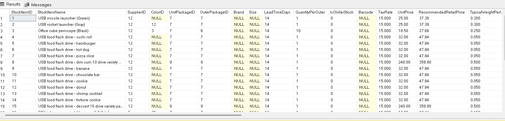
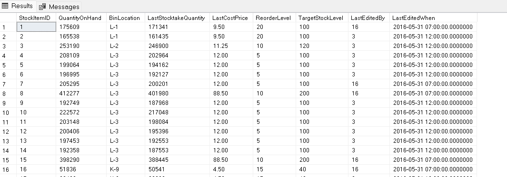
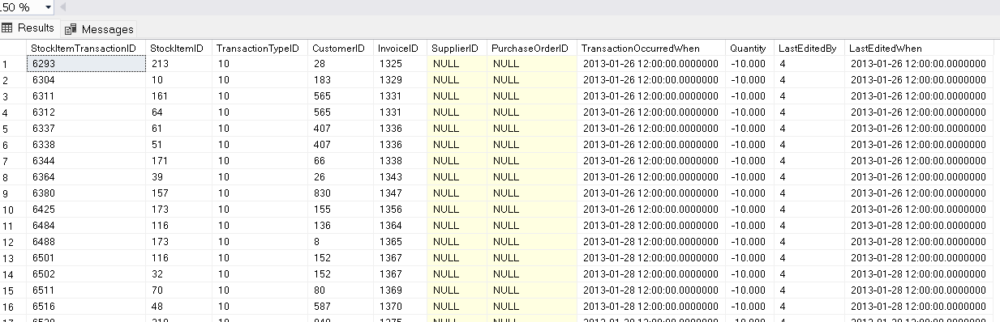
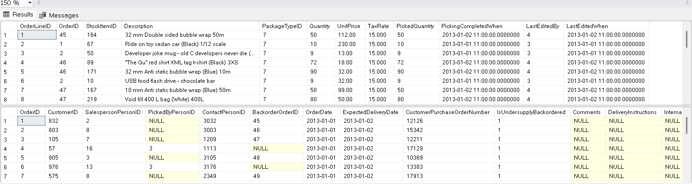
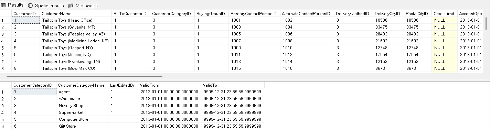
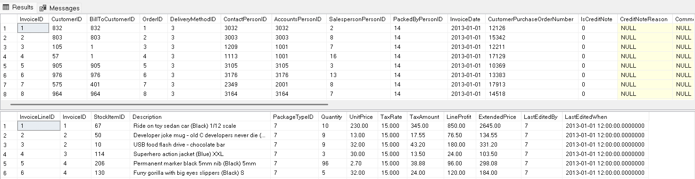
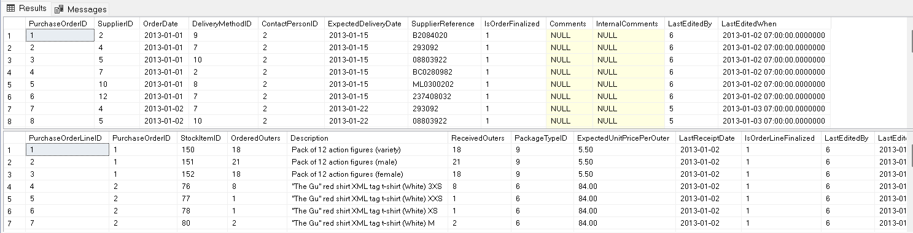

<h1>Identificación de entidades, relaciones y datos disponibles</h1>

<h2>1. De las preguntas de negocio al modelo analítico</h2>

Antes de comenzar a diseñar dashboards atractivos o escribir código para desarrollar una solución de Business Intelligence (BI) y analitica de negocio, considero fundamental comprender qué preguntas de negocio necesito responder y con qué información cuento para hacerlo.

Por esta razón, el siguiente paso de mi proyecto consiste en explorar la base de datos operacional (OLTP) KireImports, con el propósito de identificar los datos disponibles, comprender cómo están estructurados y analizar las relaciones entre las principales entidades del negocio.

Mi objetivo no es construir un modelo analítico únicamente porque dispongo de herramientas para hacerlo, sino asegurarme de que su diseño responda a las problemáticas empresariales identificadas previamente, especialmente aquellas relacionadas con la gestión de inventarios y el pronóstico de la demanda.

A partir de este proceso de descubrimiento de datos, busco determinar qué información es relevante para los análisis, qué limitaciones presenta la base de datos y si los datos disponibles son suficientes para generar indicadores y análisis confiables.

De esta manera, pretendo establecer una base sólida para construir un modelo analítico que transforme los datos operacionales en información útil para comprender el comportamiento del negocio, anticipar necesidades y respaldar la toma de decisiones.

## Entidad de articulos: `Warehouse.StockItems`

Esta tabla representa el catálogo principal de artículos comercializados por KireImports. Es una entidad central porque permite identificar cada producto y conectar sus características con los registros de ventas, compras y movimientos de inventario.

  

| Columna | Significado | Utilidad analítica |
|---|---|---|
| `StockItemID` | Identificador único del producto. | Relacionar ventas, compras e inventario. |
| `StockItemName` | Nombre del producto. | Identificar productos en reportes. |
| `SupplierID` | Proveedor habitual. | Analizar dependencia del proveedor. |
| `UnitPrice` | Precio unitario de venta configurado. | Analizar precios y valores comerciales. |
| `RecommendedRetailPrice` | Precio de venta al público recomendado. | Comparar referencias de precios. |
`UnitPackageID` | Identificador del tipo de empaque para la unidad individual del producto. | Define la unidad base de conteo y comercialización para las líneas de pedido y stock. |
| `OuterPackageID` | Identificador del tipo de empaque exterior o caja contenedora. | Facilita la planificación logística, el cálculo de volumen y la gestión de reabastecimiento por lote o caja. |
| `QuantityPerOuter` | Unidades por empaque exterior. | Interpretar cantidades de compra y embalaje. |
`ValidFrom` | Marca temporal de inicio de vigencia del registro o estado en el sistema. | Permite auditorías históricas y control de versiones del inventario (Tipo 2). |
| `ValidTo` | Marca temporal de fin de vigencia del registro o estado. | Esencial para reconstruir la foto histórica del inventario en un periodo determinado. |

**Aplicación al modelo analítico:** esta entidad puede convertirse en una dimensión de productos que permita analizar métricas por artículo, marca, proveedor y otras características. Los identificadores deben conservarse para relacionarla con las tablas de hechos.

---

## Entidad de existencias: `Warehouse.StockItemHoldings`

Esta tabla contiene información sobre las existencias de los productos. Sus valores representan el estado registrado del inventario y no deben interpretarse automáticamente como un historial completo de existencias.

  

| Columna | Significado | Utilidad analítica |
|---|---|---|
| `StockItemID` | Identificador del producto. | Relacionar existencias con el catálogo. |
| `QuantityOnHand` | Cantidad disponible registrada en existencias. | Evaluar el stock actual. |
| `LastStocktakeQuantity` | Cantidad registrada en el último conteo físico. | Comparar registros con conteos de inventario. |
| `LastCostPrice` | Último costo registrado. | Estimar el valor del inventario, previa validación. |
| `TargetStockLevel` | Nivel de existencias objetivo. | Comparar el stock disponible con el objetivo. |
|`LastEditedWhen` | Marca de tiempo de la última modificación o actualización del registro en el origen. | Sirve como referencia temporal de la carga inicial del snapshot y para auditoría o cargas incrementales. |

**Aplicación al modelo analítico:** esta entidad puede apoyar indicadores como stock actual, brecha frente al nivel objetivo y productos que se encuentran por debajo del nivel de reorden.

Por ejemplo, se puede calcular:

`Brecha de stock = TargetStockLevel - QuantityOnHand`

Un resultado positivo indica que el stock actual está por debajo del nivel objetivo. Sin embargo, esto no significa necesariamente que el producto esté agotado ni que deba realizarse una compra inmediata.

---

## Entidad de movimientos: `Warehouse.StockItemTransactions`

Esta tabla registra transacciones relacionadas con los movimientos de los artículos, incluidas operaciones de recepción, venta y otros movimientos de inventario. Es relevante para investigar cómo cambia el inventario a lo largo del tiempo.

  

| Columna | Significado | Utilidad analítica |
|---|---|---|
| `StockItemTransactionID` | Identificador de la transacción. | Identificar cada movimiento. |
| `StockItemID` | Producto afectado. | Agrupar movimientos por artículo. |
| `TransactionTypeID` | Tipo de transacción. | Diferenciar clases de movimiento mediante su catálogo. |
| `CustomerID` | Cliente relacionado, cuando corresponde. | Analizar movimientos asociados a clientes. |
| `InvoiceID` | Factura relacionada, cuando corresponde. | Vincular movimientos con operaciones facturadas. |
| `SupplierID` | Proveedor relacionado, cuando corresponde. | Investigar movimientos de abastecimiento. |
| `PurchaseOrderID` | Pedido de compra relacionado, cuando corresponde. | Conectar recepciones con compras. |
| `TransactionOccurredWhen` | Fecha y hora del movimiento. | Analizar la evolución temporal. |
| `Quantity` | Cantidad registrada en la transacción. | Cuantificar movimientos por tipo. |

**Aplicación al modelo analítico:** esta tabla puede servir para estudiar entradas, salidas y ajustes. Antes de calcular el stock histórico, es necesario comprobar el signo de las cantidades, los tipos de transacción y si todos los movimientos relevantes están registrados.

---

## Entidades de pedidos: `Sales.Orders` y `Sales.OrderLines`

Estas tablas trabajan conjuntamente: `Orders` describe el encabezado del pedido, mientras que `OrderLines` registra los productos y las cantidades solicitadas.

  

### Tabla `Sales.Orders`

| Columna | Significado | Utilidad analítica |
|---|---|---|
| `CustomerID` | Cliente que realiza el pedido. | Analizar pedidos por cliente. |
| `OrderDate` | Fecha del pedido. | Estudiar el comportamiento temporal de los pedidos. |

### Tabla `Sales.OrderLines`

| Columna | Significado | Utilidad analítica |
|---|---|---|
| `OrderLineID` | Identificador de la línea. | Identificar cada línea del pedido. |
| `OrderID` | Pedido al que pertenece. | Relacionar el detalle con el encabezado. |
| `StockItemID` | Producto solicitado. | Analizar pedidos por producto. |
| `Quantity` | Cantidad solicitada. | Medir la demanda expresada en pedidos. |
| `UnitPrice` | Precio unitario registrado en la línea. | Analizar el valor de los pedidos. |

**Aplicación al modelo analítico:** estas tablas permiten analizar las cantidades solicitadas y estudiar el comportamiento histórico de los pedidos como una aproximación a la demanda. Esta información puede utilizarse como base para preparar las series temporales y desarrollar modelos de pronóstico.

---
## Entidades de clientes: `Sales.Customers` `Sales.CustomerCategories` `Application.Cities` y `Application.Countries`

La construcción de esta dimensión integra múltiples fuentes transaccionales: Sales.Customers registra los datos generales del cliente, y se complementa con Sales.CustomerCategories para la segmentación comercial. Por otro lado, la ubicación geográfica se consolida vinculando Application.Cities con Application.Countries, permitiendo estructurar un análisis territorial robusto.

  

### Tabla `Sales.Customers`

| Columna | Significado | Utilidad analítica |
| --- | --- | --- |
| `CustomerID`| Clave natural (*Natural Key*) del cliente en la fuente. | Identificador único del cliente en el sistema operacional. |
| `CustomerName`| Nombre o razón social del cliente. | Identificar clientes en reportes comerciales y tableros analíticos. |
| `ValidFrom`| Fecha/hora de inicio de vigencia del registro. | Controlar el inicio del historial del cliente (SCD Tipo 2). |
| `ValidTo`| Fecha/hora de fin de vigencia del registro. | Reconstruir la foto histórica del cliente en un periodo determinado. |
| `IsCurrent`| Indicador de registro activo (`1` o `0`). | Filtrar rápidamente la versión vigente del cliente sin evaluar fechas. |

---

### Tabla `Sales.CustomerCategories`

| Columna | Significado | Utilidad analítica |
| --- | --- | --- |
| `CustomerCategory`| Categoría o tipo de cliente (ej. Mayorista, Minorista). | Segmentar ventas y analizar el comportamiento comercial por tipo de cliente. |

---

### Tabla `Application.Cities` y `Application.Countries`

| Columna | Significado | Utilidad analítica |
| --- | --- | --- |
| `DeliveryCity` | Ciudad de entrega asignada al cliente. | Facilitar el análisis geográfico y la planificación logística a nivel ciudad. |
| `Countrie` | País asociado a la ubicación del cliente. | Agrupar métricas y generar reportes geográficos a nivel país. |

**Aplicación al modelo analítico:**
Esta información permite estudiar el comportamiento de compra por segmentos de clientes y regiones geográficas, sirviendo como base fundamental para la segmentación avanzada, análisis de rentabilidad por cliente y la identificación de patrones de consumo a lo largo del tiempo.

---

## Entidades de ventas facturadas: `Sales.Invoices` y `Sales.InvoiceLines`

Estas tablas permiten analizar las ventas facturadas, las cantidades comercializadas y su evolución histórica. Desde la perspectiva del abastecimiento, es importante distinguir entre las cantidades solicitadas por los clientes y las cantidades facturadas, ya que pueden existir diferencias entre ambas.

  

### Tabla `Sales.Invoices`

| Columna | Significado | Utilidad analítica |
|---|---|---|
| `CustomerID` | Cliente asociado. | Segmentar el análisis por cliente. |
| `InvoiceDate` | Fecha de la factura. | Analizar la evolución temporal de la facturación. |

### Tabla `Sales.InvoiceLines`

| Columna | Significado | Utilidad analítica |
|---|---|---|
| `InvoiceLineID` | Identificador de la línea de factura. | Identificar cada registro de detalle. |
| `InvoiceID` | Factura a la que pertenece. | Relacionar el detalle con la factura. |
| `StockItemID` | Producto facturado. | Analizar cantidades por producto. |
| `Quantity` | Cantidad registrada en la línea. | Construir métricas de volumen facturado. |
| `UnitPrice` | Precio unitario registrado. | Analizar precios e importes. |

**Aplicación al modelo analítico:** `InvoiceLines` puede servir como base para una tabla de hechos de ventas, con granularidad de una línea de factura. La fecha se obtiene de `Invoices.InvoiceDate`, y las características del producto se incorporan desde `Warehouse.StockItems`.

Para el pronóstico, se pueden agregar las cantidades por producto y periodo. Si el objetivo es estimar la demanda y no solamente las ventas registradas, también será necesario considerar la demanda no satisfecha.

---

## Entidades de compras: `Purchasing.PurchaseOrders`, `Purchasing.PurchaseOrderLines` y `Purchasing.Suppliers`

Estas tablas permiten investigar cómo se abastece la empresa y qué información existe para analizar la relación con los proveedores.

  

### Tabla `Purchasing.PurchaseOrders`

| Columna | Significado | Utilidad analítica |
|---|---|---|
| `SupplierID` | Proveedor del pedido. | Analizar compras por proveedor. |
| `OrderDate` | Fecha del pedido. | Estudiar la planificación de compras. |

### Tabla `Purchasing.PurchaseOrderLines`

| Columna | Significado | Utilidad analítica |
|---|---|---|
| `PurchaseOrderLineID` | Identificador de la línea de compra. | Identificar cada registro. |
| `PurchaseOrderID` | Pedido al que pertenece. | Relacionar el detalle con el encabezado. |
| `StockItemID` | Producto comprado. | Analizar compras por producto. |
| `OrderedOuters` | Cantidad de empaques exteriores solicitados. | Analizar cantidades de compra. |
| `ReceivedOuters` | Cantidad de empaques exteriores recibidos. | Comparar cantidades solicitadas y recibidas. |
| `ExpectedUnitPricePerOuter` | Precio unitario esperado por empaque exterior. | Analizar costos esperados de adquisición. |
| `LastReceiptDate` | Fecha de la última recepción registrada para la línea. | Investigar entregas y recepciones. |
| `IsOrderLineFinalized` | Indica si la línea está finalizada. | Examinar el estado de los registros. |

---

## Entidades de proveedores: `Purchasing.Suppliers`, `Purchasing.SupplierCategories`

Esta entidad contiene información de los proveedores, como `SupplierID`, `SupplierName`, `SupplierCategoryID`

### Tabla `Purchasing.Suppliers`

| Columna | Significado | Utilidad analítica |
| --- | --- | --- | --- |
| `SupplierSK` | Clave sustituta (*Surrogate Key*) de la dimensión proveedor. | Clave primaria técnica del Data Warehouse para modelado dimensional y trazabilidad de cambios (SCD Tipo 2). |
| `SupplierID` | Clave de negocio / clave natural (*Natural Key*) del proveedor en la fuente. | Identificador único del proveedor en el sistema transaccional (OLTP). |
| `SupplierName` | Nombre o razón social del proveedor. | Identificar proveedores en reportes de compras, análisis de costos y abastecimiento. |
| `ValidFrom` | Fecha/hora de inicio de vigencia de la versión del registro. | Marca el inicio del historial del proveedor en el modelo SCD Tipo 2. |
| `ValidTo` | Fecha/hora de fin de vigencia de la versión del registro. | Permite reconstruir la historia del proveedor en un periodo determinado. |
| `IsCurrent` | Indicador de versión activa (`1` o `0`). | Filtrar de forma rápida la versión vigente del proveedor en tableros analíticos. |

---

### Tabla `Purchasing.SupplierCategories`

| Columna | Significado | Utilidad analítica |
| --- | --- | --- | --- |
| `SupplierCategoryName` | Categoría o tipo de proveedor (ej. Servicios, Fabricante, Distribuidor). | Permitir la segmentación comercial y evaluar la dependencia de abastecimiento por tipo de proveedor. |

---

### Tablas Geográficas (`Application`)

| Columna | Columna Origen (OLTP) | Significado | Utilidad analítica |
| :--- | :--- | :--- | :--- |
| `DeliveryCityName` | `CityName` (`Application.Cities`) | Ciudad de entrega/despacho asociada al proveedor. | Facilitar el análisis de logística local y rutas a nivel ciudad. |
| `StateProvinceName` | `StateProvinceName` (`Application.StateProvinces`) | Estado o provincia de ubicación del proveedor. | Permitir análisis macro-regionales y evaluaciones de riesgo de suministro por estado. |
| `Countrie` | `CountryName` (`Application.Countries`) | País de origen o radicación del proveedor. | Agrupar métricas de compras y evaluar riesgos de la cadena de suministro a nivel internacional. |

**Aplicación al modelo analítico:** estas entidades pueden ayudar a estudiar la relación entre demanda prevista y abastecimiento, comparar cantidades solicitadas con recibidas y analizar los plazos de suministro. Para calcular tiempos de entrega reales, es necesario definir qué fecha de recepción utilizar y validar la disponibilidad de registros completos.

