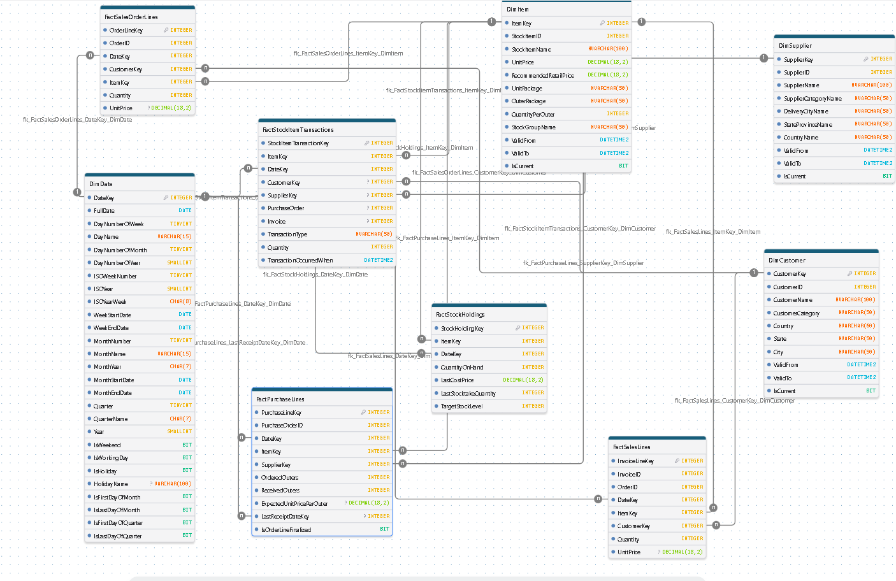

# Arquitectura del Data Warehouse: Esquema de Constelación (Star Schema Constellation)

  

## Enfoque Estratégico: Análisis de Inventarios, Planificación de la Demanda, Abastecimiento y Business Intelligence

## 1\. Descripción General y Visión Estratégica

La arquitectura del Data Warehouse de **KireImports** está diseñada para integrar y consolidar la información de los principales procesos comerciales y operativos de la organización, proporcionando una infraestructura analítica orientada al **análisis de inventarios, planificación de la demanda (Demand Planning), abastecimiento (Procurement) y Business Intelligence (BI)**.

El modelo implementa una arquitectura de **Constelación de Estrellas (Star Schema Constellation)** basada en los principios de la metodología de Ralph Kimball y su arquitectura de bus de datos (*Data Warehouse Bus Architecture*). Esta estructura integra múltiples procesos de negocio mediante el uso de **dimensiones conformadas (Conformed Dimensions)**, permitiendo analizar de manera consistente las relaciones entre ventas, compras, proveedores y movimientos de inventario.

El propósito principal es proporcionar una visión integral de la cadena de suministro, conectando el comportamiento de la demanda con las operaciones de abastecimiento y la disponibilidad de inventario.

A partir de esta infraestructura, se busca desarrollar capacidades analíticas que permitan:

-   Analizar el comportamiento histórico de la demanda y las ventas.
-   Evaluar el desempeño y la disponibilidad del inventario.
-   Identificar patrones de consumo, tendencias y comportamientos estacionales.
-   Analizar el desempeño de proveedores y las operaciones de abastecimiento.
-   Desarrollar análisis de series temporales y modelos de pronóstico de demanda (*Demand Forecasting*).
-   Generar información estratégica para respaldar la planificación de inventarios y la toma de decisiones.

La información consolidada estará disponible para su explotación mediante herramientas de Business Intelligence, principalmente Power BI, y podrá servir posteriormente como fuente de datos para modelos estadísticos y soluciones analíticas más avanzadas.

## 2\. Componentes del Modelo Global

### A. Dimensiones Compartidas (Conformed Dimensions)

Las dimensiones conformadas constituyen la estructura común de segmentación y análisis de los diferentes procesos de negocio. Su implementación permite mantener criterios consistentes al relacionar información de ventas, inventarios y abastecimiento.

-   **`**DimItem**` (Productos):** Representa el catálogo de productos comercializados por la organización. Permite analizar el comportamiento de la demanda, las ventas y el inventario según las características de cada artículo, sus grupos de stock, precios y presentaciones de empaque. Implementa **SCD Tipo 2** para conservar el historial de cambios relevantes en los atributos de los productos y permitir análisis históricos consistentes.
-   **`**DimCustomer**` (Clientes):** Permite segmentar y analizar el comportamiento comercial de los clientes mediante sus características y ubicación geográfica. Facilita la identificación de patrones de compra, concentración de demanda y comportamiento de consumo por regiones, ciudades y categorías de clientes. Contempla **SCD Tipo 2** para conservar los cambios históricos de los atributos definidos para seguimiento.
-   **`**DimSupplier**` (Proveedores):** Constituye un componente fundamental para el análisis de abastecimiento. Permite evaluar a los proveedores según su categoría, ubicación geográfica y participación en las operaciones de compra. Facilita el análisis histórico de las relaciones comerciales y los cambios en sus características mediante **SCD Tipo 2**.
-   **`**DimDate**` (Tiempo):** Dimensión temporal creada específicamente para el Data Warehouse, sin depender de una tabla de origen del sistema OLTP. Proporciona atributos calendarios, jerarquías temporales y clasificaciones operativas como `IsWorkingDay`, `IsHoliday`, `IsFirstDayOfMonth` e `IsLastDayOfMonth`. Es fundamental para analizar tendencias, estacionalidad, comportamiento semanal y mensual, series temporales y planificación de la demanda.

### B. Tablas de Hechos Integradas para el Análisis de la Cadena de Suministro

El modelo integra cinco tablas de hechos especializadas, cada una diseñada para representar un proceso de negocio y una granularidad analítica específica.

1.  **`**FactSalesOrderLines**` (Líneas de Órdenes de Venta):** Registra los productos solicitados por los clientes mediante sus órdenes de venta. Constituye una fuente fundamental para estudiar el comportamiento histórico de los pedidos y la demanda comercial, identificar patrones de solicitud y analizar la evolución de los requerimientos de los clientes. Su información puede utilizarse como insumo para los análisis de planificación de la demanda.
2.  **`**FactSalesLines**` (Líneas de Facturación):** Registra las operaciones de venta facturadas y permite analizar la demanda comercial materializada, los volúmenes vendidos y los ingresos generados. Facilita el estudio de tendencias de ventas, comportamiento de consumo y evolución del desempeño comercial.
3.  **`**FactPurchaseLines**` (Líneas de Órdenes de Compra):** Registra los productos solicitados a los proveedores mediante órdenes de compra. Permite analizar las cantidades adquiridas, los costos de adquisición y el comportamiento de las operaciones de abastecimiento. Constituye una fuente para evaluar el desempeño de los proveedores y estudiar la relación entre las necesidades de inventario y las decisiones de compra.
4.  **`**FactStockItemTransactions**` (Transacciones de Inventario):** Registra los movimientos de inventario asociados a las entradas y salidas de mercancía. Permite analizar la dinámica del stock, identificar patrones de movimiento, estudiar la rotación de productos y comprender el comportamiento de las existencias a través del tiempo.
5.  **`**FactStockHoldings**` (Existencias de Inventario):** Representa las existencias de inventario mediante una estructura de tipo *Periodic Snapshot*. Permite analizar los niveles de stock disponibles en determinados momentos de referencia, identificar acumulaciones, posibles excesos y situaciones de escasez, además de estudiar la evolución de las existencias por producto y período.

## 3\. Integración Estratégica para el Negocio

La arquitectura permite integrar diferentes procesos de negocio para construir una visión analítica transversal de la operación.

-   **Integración de la Demanda y las Ventas:** Relaciona los pedidos realizados por los clientes (`FactSalesOrderLines`) con las ventas facturadas (`FactSalesLines`), permitiendo estudiar la evolución de la demanda comercial, comparar pedidos con ventas materializadas y analizar patrones históricos de consumo.
-   **Integración del Abastecimiento y los Proveedores:** Conecta las operaciones de compra (`FactPurchaseLines`) con la dimensión de proveedores (`DimSupplier`), facilitando el análisis de costos de adquisición, volúmenes solicitados y comportamiento de las operaciones de abastecimiento.
-   **Integración del Flujo y Disponibilidad de Inventario:** Relaciona las transacciones de inventario (`FactStockItemTransactions`) con las existencias periódicas (`FactStockHoldings`), proporcionando información para estudiar los movimientos de mercancía y la evolución de los niveles de inventario.
-   **Soporte para la Planificación de la Demanda (Demand Planning):** La disponibilidad de información histórica sobre pedidos, ventas y existencias, vinculada mediante dimensiones conformadas y una dimensión temporal robusta, proporciona una base analítica para desarrollar estudios de demanda, identificar tendencias, evaluar estacionalidad y construir modelos de pronóstico.
-   **Business Intelligence y Gobierno de Datos:** La integración mediante dimensiones conformadas permite desarrollar modelos de análisis en Power BI, manteniendo criterios uniformes de segmentación y facilitando la comparación de indicadores entre los diferentes procesos de negocio.

## 4\. Casos de Uso Analíticos y Aplicaciones de Negocio

La arquitectura del Data Warehouse está diseñada para respaldar los siguientes escenarios analíticos:

### 1\. Análisis y Control de Inventarios

-   Evaluación de los niveles de existencias por producto y grupo de stock.
-   Identificación de productos con acumulación o escasez de inventario.
-   Análisis de entradas y salidas de mercancía.
-   Estudio de la rotación y comportamiento histórico del inventario.
-   Evaluación de la evolución de las existencias a través del tiempo.

### 2\. Planificación de la Demanda (Demand Planning)

-   Análisis del comportamiento histórico de los pedidos y las ventas.
-   Identificación de patrones de consumo y tendencias de demanda.
-   Análisis de estacionalidad por semana, mes, trimestre y año.
-   Identificación de variaciones en los requerimientos comerciales.
-   Generación de información histórica para respaldar la planificación de necesidades futuras.

### 3\. Pronóstico de Demanda (Demand Forecasting)

-   Preparación de conjuntos de datos históricos para modelos de pronóstico.
-   Análisis de series temporales para identificar tendencias y componentes estacionales.
-   Evaluación del comportamiento de la demanda por producto.
-   Desarrollo y evaluación de modelos de forecasting.
-   Utilización de los resultados de pronóstico como insumo para la planificación de inventarios y abastecimiento.

### 4\. Análisis de Abastecimiento y Desempeño de Proveedores

-   Evaluación de los volúmenes de compra por proveedor y producto.
-   Análisis de costos de adquisición.
-   Seguimiento de las cantidades solicitadas mediante órdenes de compra.
-   Estudio del comportamiento histórico de las operaciones de abastecimiento.
-   Identificación de patrones de compra y oportunidades de optimización.

### 5\. Business Intelligence y Análisis Ejecutivo

-   Construcción de dashboards en Power BI para el seguimiento de indicadores comerciales y operativos.
-   Integración de indicadores de ventas, compras e inventarios.
-   Análisis multidimensional mediante jerarquías y operaciones de *Drill-Down*.
-   Comparación de resultados entre diferentes períodos.
-   Seguimiento de indicadores clave de desempeño (*KPIs*) para respaldar la toma de decisiones.

## 5\. Visión de Evolución de la Arquitectura

El Data Warehouse de KireImports constituye la base de una infraestructura analítica que podrá evolucionar progresivamente hacia capacidades más avanzadas de ingeniería y análisis de datos.

Una vez consolidada la arquitectura de integración, transformación y almacenamiento, la información podrá aprovecharse para implementar procesos analíticos adicionales, modelos de predicción y soluciones de automatización.

Entre las posibles líneas de evolución se encuentran:

-   Implementación de modelos estadísticos y algoritmos de Machine Learning para el pronóstico de demanda.
-   Automatización de procesos de planificación de inventarios.
-   Incorporación de mecanismos de Data Quality y Data Observability para garantizar la integridad, consistencia y confiabilidad de los datos.
-   Implementación de controles de trazabilidad y validación a lo largo del proceso ETL.
-   Integración futura de agentes de Inteligencia Artificial para facilitar la consulta, interpretación y aprovechamiento de la información almacenada.

**En conjunto, KireImports busca consolidar una arquitectura de datos orientada al negocio, capaz de transformar los registros operativos en información analítica confiable y convertir esa información en conocimiento útil para la gestión de inventarios, la planificación de la demanda, el abastecimiento y la toma de decisiones estratégicas.**

\*Nota de herramientas:\* Todos los diagramas de modelos dimensionales incluidos en este documento fueron diseñados utilizando \[DrawDB\](https://www.drawdb.app/).

