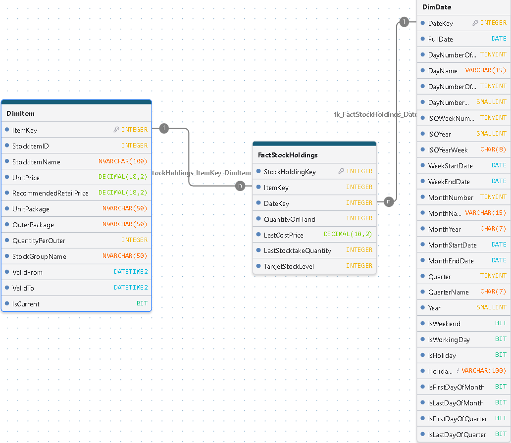

<h1>Modelado por Procesos de Negocio e Integración del Modelo Dimensional (Constelación) del Data Warehouse</h1>

Esta sección documenta el diseño del modelo dimensional del Data Warehouse, tomando como referencia los diferentes procesos de negocio. Mediante un enfoque de modelado analítico, se representa cada proceso de manera individual a través de su correspondiente esquema estrella, definiendo su granularidad, tablas de hechos, dimensiones, relaciones y métricas de análisis.

Estas representaciones constituyen la base del diseño dimensional del Data Warehouse, cuya arquitectura estará conformada por un modelo constelación, que integrará los diferentes procesos de negocio mediante dimensiones conformadas. De esta manera, se busca proporcionar una visión analítica unificada de las operaciones, facilitando el análisis, el seguimiento de indicadores clave y la toma de decisiones mediante herramientas de Business Intelligence.

Finalmente, al término de este documento se presenta el diseño dimensional integrado del Data Warehouse, representado mediante el modelo constelación que reúne los diferentes procesos de negocio en una arquitectura analítica unificada.

# Modelo Dimensional: Daily Inventory Snapshot Data Mart

  

## 1\. Descripción General

Este modelo en estrella (*Star Schema*) está diseñado para el análisis cuantitativo, seguimiento y valoración periódica de los niveles de inventario.

Implementa un patrón de hechos de instantánea periódica (*Periodic Snapshot Fact Table*), que registra diariamente el estado de las existencias por producto. Esto permite conservar un historial de inventario y analizar su evolución a lo largo del tiempo, facilitando el monitoreo de disponibilidad, cumplimiento de niveles objetivo, necesidades de abastecimiento y valoración del inventario.

## 2\. Arquitectura del Modelo

-   **Grano del Modelo:** Un registro representa un producto (`ItemKey`) en una fecha específica de captura diaria (`DateKey`).
-   **Tipo de Esquema:** Modelo estrella (*Star Schema*), siguiendo los principios de modelado dimensional de Ralph Kimball.
-   **Tabla de Hechos:** `FactStockHoldings`.
-   **Dimensiones:** `DimItem` (Productos) y `DimDate` (Tiempo).
-   **Tipo de Hecho:** Fotografía periódica (*Periodic Snapshot*).

### Integridad y granularidad

-   Se establece una restricción de unicidad compuesta sobre `ItemKey` y `DateKey`, garantizando que cada producto tenga un único registro por fecha de captura.
-   La tabla conserva históricamente las fotografías diarias, sin sobrescribir los registros de períodos anteriores.

## 3\. Métricas y Atributos de Análisis

-   `QuantityOnHand`: Cantidad de unidades disponibles en inventario al momento de la captura.
-   `LastCostPrice`: Último costo unitario registrado para el producto.
-   `LastStocktakeQuantity`: Cantidad registrada en el último conteo físico de inventario.
-   `TargetStockLevel`: Nivel objetivo de existencias establecido para el producto.

## 4\. Casos de Uso del Negocio

1.  **Valoración de Inventario:** Cálculo del valor estimado de las existencias en bodega mediante la multiplicación de QuantityOnHand x LastCostPrice, permitiendo analizar su evolución y valor en diferentes fechas de corte.
2.  **Control de Abastecimiento:** Monitoreo del cumplimiento de los niveles objetivo de inventario QuantityOnHand vs TargetStockLevel, identificando productos con existencias inferiores a los niveles establecidos.
3.  **Auditoría y Control de Inventario:** Comparación entre las existencias registradas en el sistema y las cantidades reportadas en el último conteo físico (`LastStocktakeQuantity`), facilitando la identificación de posibles diferencias.
4.  **Análisis de Tendencias:** Evaluación de la evolución diaria, semanal y mensual de las existencias, identificando patrones de acumulación, reducción y variaciones del inventario.
5.  **Análisis de Cobertura y Disponibilidad:** Seguimiento de los niveles de existencias por producto y período, proporcionando información para evaluar la disponibilidad de inventario y apoyar las decisiones de abastecimiento.

## 5\. Consideraciones Analíticas

Las métricas de inventario requieren un tratamiento específico durante la agregación:

-   `QuantityOnHand` es una métrica **semi-aditiva**: puede agregarse entre productos para una misma fecha, pero no debe sumarse entre diferentes fechas.
-   `LastCostPrice` y `TargetStockLevel` son atributos **no aditivos**.
-   La valoración del inventario debe calcularse considerando las cantidades y los costos correspondientes a cada producto en la fecha analizada.

Estas consideraciones permiten construir indicadores consistentes y evitar errores de agregación en las herramientas de análisis, especialmente en Power BI.
