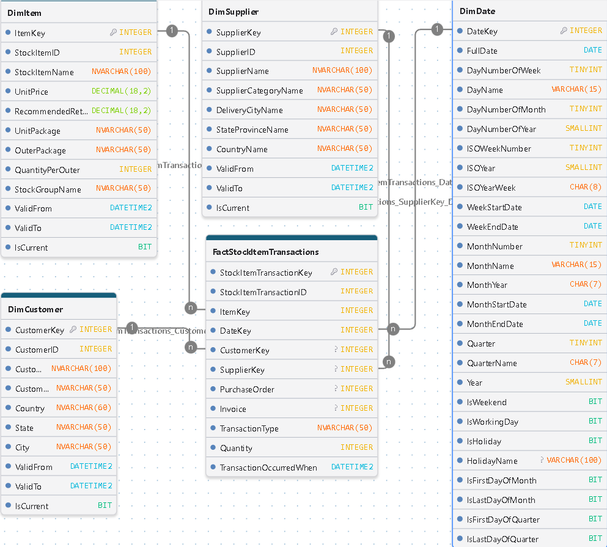
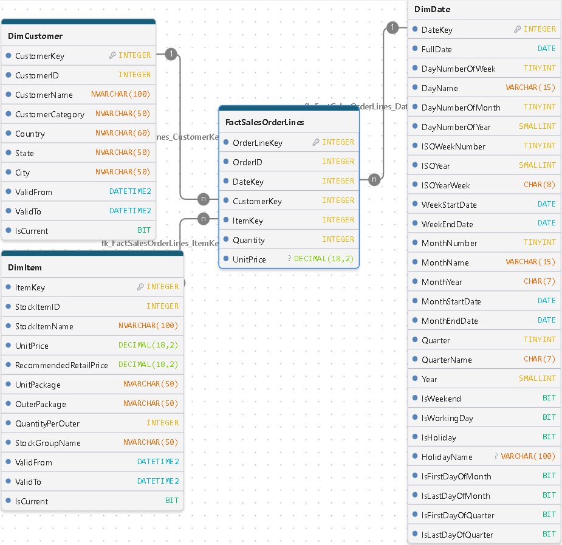

<h1>Modelado por Procesos de Negocio e Integración del Modelo Dimensional (Constelación) del Data Warehouse</h1>

Esta sección documenta el diseño del modelo dimensional del Data Warehouse, tomando como referencia los diferentes procesos de negocio. Mediante un enfoque de modelado analítico, se representa cada proceso de manera individual a través de su correspondiente esquema estrella, definiendo su granularidad, tablas de hechos, dimensiones, relaciones y métricas de análisis.

Estas representaciones constituyen la base del diseño dimensional del Data Warehouse, cuya arquitectura estará conformada por un modelo constelación, que integrará los diferentes procesos de negocio mediante dimensiones conformadas. De esta manera, se busca proporcionar una visión analítica unificada de las operaciones, facilitando el análisis, el seguimiento de indicadores clave y la toma de decisiones mediante herramientas de Business Intelligence.

Finalmente, al término de este documento se presenta el diseño dimensional integrado del Data Warehouse, representado mediante el modelo constelación que reúne los diferentes procesos de negocio en una arquitectura analítica unificada.

# Modelo Dimensional: Daily Inventory Snapshot

  

## 1\. Descripción General

Este modelo en estrella (*Star Schema*) está diseñado para el análisis cuantitativo, seguimiento y valoración periódica de los niveles de inventario.

Implementa un patrón de hechos de instantánea periódica (*Periodic Snapshot Fact Table*), que registra diariamente el estado de las existencias por producto. Esto permite conservar un historial de inventario y analizar su evolución a lo largo del tiempo, facilitando el monitoreo de disponibilidad, cumplimiento de niveles objetivo, necesidades de abastecimiento y valoración del inventario.

## 2\. Arquitectura del Modelo

-   **Grano del Modelo:** Un registro representa un producto (`ItemKey`) en una fecha específica de captura diaria (`DateKey`).
-   **Tipo de Esquema:** Modelo estrella (*Star Schema*).
-   **Tabla de Hechos:** `FactStockHoldings`.
-   **Dimensiones:** `DimItem` (Productos) y `DimDate` (Tiempo).
-   **Tipo de Hecho:** Fotografía periódica (*Periodic Snapshot*).

### Integridad y granularidad

-   Se establece una restricción de unicidad compuesta sobre `ItemKey` y `DateKey`, garantizando que cada producto tenga un único registro por fecha de captura.
-   La tabla conserva históricamente las fotografías diarias, sin sobrescribir los registros de períodos anteriores.

## 3\. Métricas y Atributos de Análisis

-   `QuantityOnHand`: Cantidad de unidades disponibles en inventario al momento de la captura.
-   `LastCostPrice`: Último costo unitario registrado para el producto.
-   `LastStocktakeQuantity`: Cantidad registrada en el último conteo físico de inventario.
-   `TargetStockLevel`: Nivel objetivo de existencias establecido para el producto.

## 4\. Casos de Uso del Negocio

1.  **Valoración de Inventario:** Cálculo del valor estimado de las existencias en bodega mediante la multiplicación de QuantityOnHand x LastCostPrice, permitiendo analizar su evolución y valor en diferentes fechas de corte.
2.  **Control de Abastecimiento:** Monitoreo del cumplimiento de los niveles objetivo de inventario QuantityOnHand vs TargetStockLevel, identificando productos con existencias inferiores a los niveles establecidos.
3.  **Auditoría y Control de Inventario:** Comparación entre las existencias registradas en el sistema y las cantidades reportadas en el último conteo físico (`LastStocktakeQuantity`), facilitando la identificación de posibles diferencias.
4.  **Análisis de Tendencias:** Evaluación de la evolución diaria, semanal y mensual de las existencias, identificando patrones de acumulación, reducción y variaciones del inventario.
5.  **Análisis de Cobertura y Disponibilidad:** Seguimiento de los niveles de existencias por producto y período, proporcionando información para evaluar la disponibilidad de inventario y apoyar las decisiones de abastecimiento.

## 5\. Consideraciones Analíticas

Las métricas de inventario requieren un tratamiento específico durante la agregación:

-   `QuantityOnHand` es una métrica **semi-aditiva**: puede agregarse entre productos para una misma fecha, pero no debe sumarse entre diferentes fechas.
-   `LastCostPrice` y `TargetStockLevel` son atributos **no aditivos**.
-   La valoración del inventario debe calcularse considerando las cantidades y los costos correspondientes a cada producto en la fecha analizada.

Estas consideraciones permiten construir indicadores consistentes y evitar errores de agregación en las herramientas de análisis, especialmente en Power BI.

# Modelo Estrella de Transacciones de Inventario (FactStockItemTransactions)

  

## 1\. Descripción General

Este modelo en estrella (*Star Schema*) está diseñado para el análisis detallado y transaccional de los movimientos de inventario.

Implementa un patrón de **hechos de transacciones (*****Transaction Fact Table*****)**, el cual registra cada evento o movimiento individual que afecta el inventario (como entradas por compras, salidas por ventas, ajustes o devoluciones). A diferencia de las tablas de instantáneas, este esquema permite analizar la dinámica operativa, el volumen de operaciones y la trazabilidad completa de los productos a medida que interactúan con clientes y proveedores a lo largo del tiempo.

## 2\. Arquitectura del Modelo

-   **Grano del Modelo:** Un registro representa una transacción individual de inventario (`StockItemTransactionKey`) asociada a un producto específico, un momento en el tiempo, y opcionalmente a un cliente o proveedor.
-   **Tipo de Esquema:** Modelo estrella (*Star Schema*).
-   **Tabla de Hechos:** `FactStockItemTransactions`.
-   **Dimensiones:**
-   -   `DimItem` (Productos)
    -   `DimSupplier` (Proveedores)
    -   `DimCustomer` (Clientes)
    -   `DimDate` (Tiempo)
-   **Tipo de Hecho:** Transaccional (*Transactional Fact Table*).

### Integridad y granularidad

-   Cada fila corresponde a un movimiento o evento discreto en el sistema transaccional.
-   Las dimensiones integran control de cambios históricos mediante **SCD Tipo 2** (`ValidFrom`, `ValidTo`, `IsCurrent`), asegurando que las transacciones históricas conserven los atributos vigentes del producto, cliente o proveedor en el momento en que ocurrió el evento.

## 3\. Métricas y Atributos de Análisis

-   **Métrica Cuantitativa:**
-   -   `Quantity`: Cantidad de unidades involucradas en la transacción (positiva para entradas/ingresos, negativa o dirigida según el tipo de movimiento).
-   **Atributos Descriptivos y de Control:**
-   -   `TransactionType`: Tipo de movimiento (por ejemplo, venta, compra, ajuste de inventario).
    -   `PurchaseOrder`: Número de orden de compra asociado (si aplica).
    -   `Invoice`: Número de factura comercial asociada (si aplica).
    -   `TransactionOccurredWhen`: Marca de tiempo exacta en que ocurrió la transacción en el sistema fuente.

## 4\. Casos de Uso del Negocio

1.  **Análisis de Flujo de Inventario:** Monitoreo detallado de entradas y salidas de mercancía para entender la velocidad de rotación y el comportamiento operativo del almacén.
2.  **Trazabilidad de Ventas y Compras:** Cruce directo entre el movimiento de stock y los actores involucrados (`DimCustomer` y `DimSupplier`), permitiendo auditar qué cliente adquirió qué producto o qué proveedor lo suministró.
3.  **Auditoría de Documentos Comerciales:** Seguimiento de operaciones respaldadas por órdenes de compra e facturas (`PurchaseOrder`, `Invoice`) para conciliar inventarios físicos con registros administrativos.
4.  **Análisis de Patrones Operativos por Período:** Evaluación de volúmenes de transacciones agrupados por días hábiles, fines de semana o cierres mensuales utilizando la robusta estructura de `DimDate`.

## 5\. Consideraciones Analíticas

-   `Quantity` es una métrica **completamente aditiva**: puede sumarse a través de cualquier dimensión (por producto, tipo de transacción, cliente, proveedor o período de tiempo) sin restricciones.
-   Permite complementar los análisis de saldo estático (*Stock Holdings*) con la dinámica real de flujo de mercancías.

# Modelo Estrella de Líneas de Órdenes de Ventas (FactSalesOrderLines)

  

## 1\. Descripción General

Este modelo en estrella (*Star Schema*) está diseñado para el análisis comercial, de ingresos y de rendimiento de ventas.

Implementa un patrón de **hechos de transacciones por línea de orden (*****Transactional Fact Table*****)**, el cual registra cada línea individual dentro de los pedidos de venta realizados por los clientes. Esto permite analizar con precisión los volúmenes de comercialización, el comportamiento de compra de los clientes y la facturación desglosada por producto a lo largo del tiempo.

## 2\. Arquitectura del Modelo

-   **Grano del Modelo:** Un registro representa una línea individual de producto (`ItemKey`) dentro de una orden de venta específica (`OrderID`), asociada a un cliente (`CustomerKey`) y una fecha de transacción (`DateKey`).
-   **Tipo de Esquema:** Modelo estrella (*Star Schema*), siguiendo los principios de modelado dimensional de Ralph Kimball.
-   **Tabla de Hechos:** `FactSalesOrderLines`.
-   **Dimensiones:**
-   -   `DimCustomer` (Clientes)
    -   `DimItem` (Productos)
    -   `DimDate` (Tiempo)
-   **Tipo de Hecho:** Transaccional por línea de detalle (*Transactional Fact Table*).

### Integridad y granularidad

-   Cada fila corresponde a una línea de detalle comercial dentro de un pedido, conectando las dimensiones clave de negocio.
-   Las dimensiones principales incorporan gestión de cambios históricos mediante **SCD Tipo 2** (`ValidFrom`, `ValidTo`, `IsCurrent`), lo que garantiza que las ventas históricas mantengan los atributos vigentes del cliente o producto al momento de la transacción.

## 3\. Métricas y Atributos de Análisis

-   **Métricas Cuantitativas:**
-   -   `Quantity`: Cantidad de unidades del producto vendidas en esa línea de orden.
    -   `UnitPrice`: Precio unitario de venta aplicado al artículo en la transacción.
-   **Atributos de Control y Descriptivos:**
-   -   `OrderLineKey`: Identificador único de la línea de orden (Clave primaria de la tabla de hechos).
    -   `OrderID`: Identificador del pedido general al que pertenece la línea.

## 4\. Casos de Uso del Negocio

1.  **Análisis de Ingresos y Facturación:** Cálculo del valor total de ventas por línea o pedido mediante la multiplicación de $\\text{Quantity} \\times \\text{UnitPrice}$, facilitando reportes financieros y comerciales.
2.  **Comportamiento y Segmentación de Clientes:** Evaluación del volumen de compras, categorías preferidas y distribución geográfica de los clientes utilizando los atributos de `DimCustomer`.
3.  **Rendimiento de Productos:** Identificación de los artículos más vendidos, clasificación por grupos de stock (`StockGroupName`) y análisis de rotación comercial a través de `DimItem`.
4.  **Análisis Temporal y Estacionalidad:** Monitoreo de tendencias de venta diarias, semanales, mensuales o por periodos hábiles/festivos gracias a la integración con `DimDate`.

## 5\. Consideraciones Analíticas

-   Las métricas cuantitativas como `Quantity` son **completamente aditivas** a través de cualquier dimensión (producto, cliente, categoría temporal o geográfica).
-   El cálculo de ingresos totales o valor de ventas se realiza de manera dinámica multiplicando cantidad por precio unitario en cada línea, asegurando precisión analítica en herramientas de Business Intelligence como Power BI.
