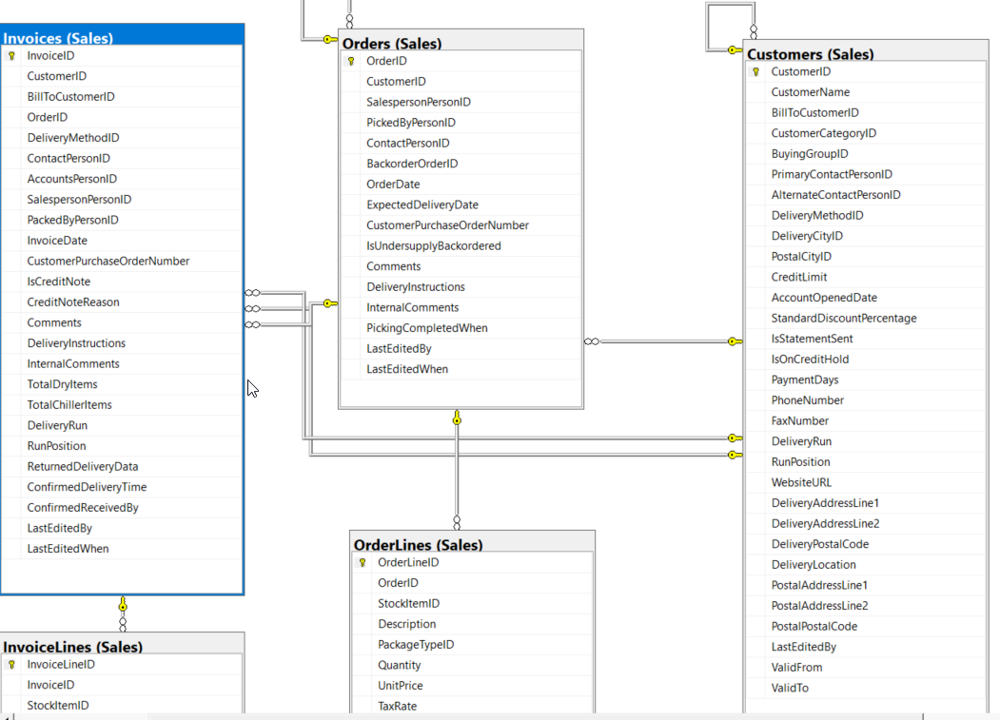

<h1>Modelado por Procesos de Negocio e Integración del Modelo Dimensional (Constelación) del Data Warehouse</h1>

Esta sección documenta el diseño del modelo dimensional del Data Warehouse, tomando como referencia los diferentes procesos de negocio. Mediante un enfoque de modelado analítico, se representa cada proceso de manera individual a través de su correspondiente esquema estrella, definiendo su granularidad, tablas de hechos, dimensiones, relaciones y métricas de análisis.

Estas representaciones constituyen la base del diseño dimensional del Data Warehouse, cuya arquitectura estará conformada por un modelo constelación, que integrará los diferentes procesos de negocio mediante dimensiones conformadas. De esta manera, se busca proporcionar una visión analítica unificada de las operaciones, facilitando el análisis, el seguimiento de indicadores clave y la toma de decisiones mediante herramientas de Business Intelligence.

Finalmente, al término de este documento se presenta el diseño dimensional integrado del Data Warehouse, representado mediante el modelo constelación que reúne los diferentes procesos de negocio en una arquitectura analítica unificada.

# Modelo Dimensional: Daily Inventory Snapshot Data Mart

  

## 📌 Descripción General
Este modelo en estrella (*Star Schema*) está diseñado para el análisis cuantitativo, seguimiento y valoración periódica de los niveles de inventario. Implementa un patrón de **hechos de instantánea periódica (*Periodic Snapshot Fact Table*)** que registra el estado diario del stock por producto, facilitando el monitoreo de disponibilidad, niveles de reabastecimiento y valoración de activos en bodega a lo largo del tiempo.

---

## 🏛️ Arquitectura del Modelo

* **Grano del Modelo:** Un registro por cada producto (`ItemKey`) por cada fecha de corte diaria (`DateKey`).
* **Tipo de Esquema:** Estrella (*Star Schema*) estandarizado bajo metodología Kimball.
