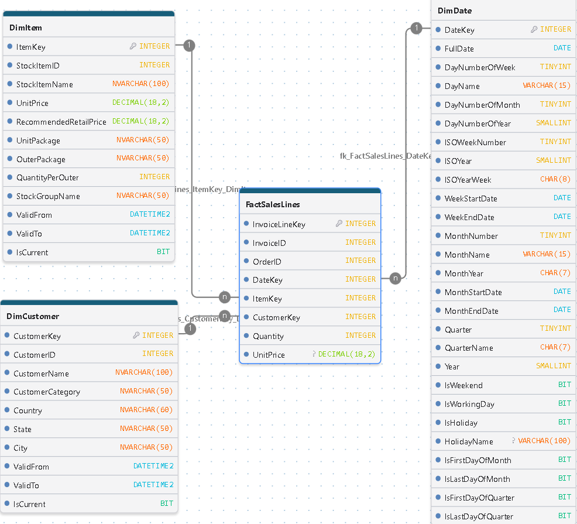
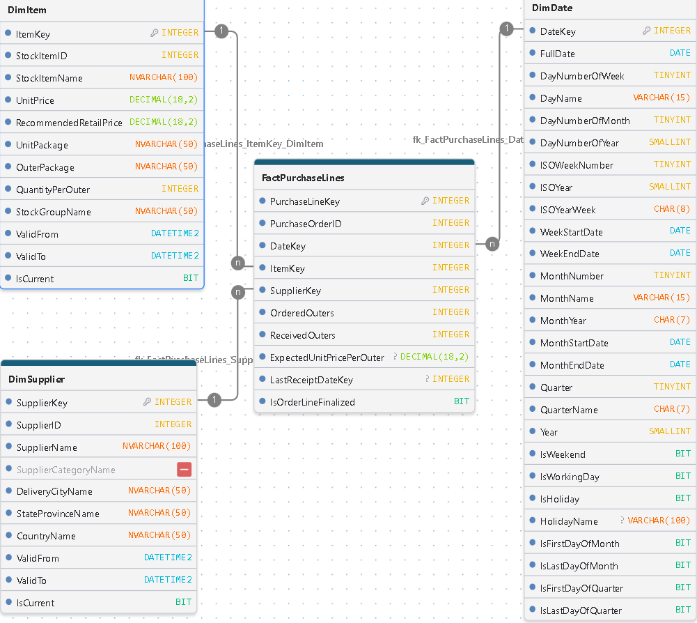

<h1>Modelado por Procesos de Negocio e Integración del Modelo Dimensional (Constelación) del Data Warehouse</h1>

Esta sección documenta el diseño del modelo dimensional del Data Warehouse, tomando como referencia los diferentes procesos de negocio. Mediante un enfoque de modelado analítico, se representa cada proceso de manera individual a través de su correspondiente esquema estrella, definiendo su granularidad, tablas de hechos, dimensiones, relaciones y métricas de análisis.

Estas representaciones constituyen la base del diseño dimensional del Data Warehouse, cuya arquitectura estará conformada por un modelo constelación, que integrará los diferentes procesos de negocio mediante dimensiones conformadas. De esta manera, se busca proporcionar una visión analítica unificada de las operaciones, facilitando el análisis, el seguimiento de indicadores clave y la toma de decisiones mediante herramientas de Business Intelligence.

Finalmente, al término de este documento se presenta el diseño dimensional integrado del Data Warehouse, representado mediante el modelo constelación que reúne los diferentes procesos de negocio en una arquitectura analítica unificada.

# Modelo Estrella: Control y Seguimiento de Inventario

  

## 1\. Descripción General

Este modelo en estrella (*Star Schema*) está diseñado para el análisis cuantitativo, seguimiento y valoración periódica de los niveles de inventario.

Implementa un patrón de hechos de instantánea periódica (*Periodic Snapshot Fact Table*), que registra diariamente el estado de las existencias por producto. Esto permite conservar un historial de inventario y analizar su evolución a lo largo del tiempo, facilitando el monitoreo de disponibilidad, cumplimiento de niveles objetivo, necesidades de abastecimiento y valoración del inventario.

## 2\. Arquitectura del Modelo

-   **Grano del Modelo:** Un registro representa un producto (`ItemKey`) en una fecha específica de captura diaria (`DateKey`).
-   **Tipo de Esquema:** Modelo estrella (*Star Schema*).
-   **Tabla de Hechos:** `FactStockHoldings`.
-   **Dimensiones:** `DimItem` (Productos) y `DimDate` (Tiempo).
-   **Tipo de Hecho:** Fotografía periódica (*Periodic Snapshot*).

### Integridad y granularidad

-   Se establece una restricción de unicidad compuesta sobre `ItemKey` y `DateKey`, garantizando que cada producto tenga un único registro por fecha de captura.
-   La tabla conserva históricamente las fotografías diarias, sin sobrescribir los registros de períodos anteriores.

## 3\. Métricas y Atributos de Análisis

-   `QuantityOnHand`: Cantidad de unidades disponibles en inventario al momento de la captura.
-   `LastCostPrice`: Último costo unitario registrado para el producto.
-   `LastStocktakeQuantity`: Cantidad registrada en el último conteo físico de inventario.
-   `TargetStockLevel`: Nivel objetivo de existencias establecido para el producto.

## 4\. Casos de Uso del Negocio

1.  **Valoración de Inventario:** Cálculo del valor estimado de las existencias en bodega mediante la multiplicación de QuantityOnHand x LastCostPrice, permitiendo analizar su evolución y valor en diferentes fechas de corte.
2.  **Control de Abastecimiento:** Monitoreo del cumplimiento de los niveles objetivo de inventario QuantityOnHand vs TargetStockLevel, identificando productos con existencias inferiores a los niveles establecidos.
3.  **Auditoría y Control de Inventario:** Comparación entre las existencias registradas en el sistema y las cantidades reportadas en el último conteo físico (`LastStocktakeQuantity`), facilitando la identificación de posibles diferencias.
4.  **Análisis de Tendencias:** Evaluación de la evolución diaria, semanal y mensual de las existencias, identificando patrones de acumulación, reducción y variaciones del inventario.
5.  **Análisis de Cobertura y Disponibilidad:** Seguimiento de los niveles de existencias por producto y período, proporcionando información para evaluar la disponibilidad de inventario y apoyar las decisiones de abastecimiento.

## 5\. Consideraciones Analíticas

Las métricas de inventario requieren un tratamiento específico durante la agregación:

-   `QuantityOnHand` es una métrica **semi-aditiva**: puede agregarse entre productos para una misma fecha, pero no debe sumarse entre diferentes fechas.
-   `LastCostPrice` y `TargetStockLevel` son atributos **no aditivos**.
-   La valoración del inventario debe calcularse considerando las cantidades y los costos correspondientes a cada producto en la fecha analizada.

Estas consideraciones permiten construir indicadores consistentes y evitar errores de agregación en las herramientas de análisis, especialmente en Power BI.

# Modelo Estrella: Transaccion de Inventario

  

## 1\. Descripción General

Este modelo en estrella (*Star Schema*) está diseñado para el análisis detallado y transaccional de los movimientos de inventario.

Implementa un patrón de **hechos de transacciones (*****Transaction Fact Table*****)**, el cual registra cada evento o movimiento individual que afecta el inventario (como entradas por compras, salidas por ventas, ajustes o devoluciones). A diferencia de las tablas de instantáneas, este esquema permite analizar la dinámica operativa, el volumen de operaciones y la trazabilidad completa de los productos a medida que interactúan con clientes y proveedores a lo largo del tiempo.

## 2\. Arquitectura del Modelo

-   **Grano del Modelo:** Un registro representa una transacción individual de inventario (`StockItemTransactionKey`) asociada a un producto específico, un momento en el tiempo, y opcionalmente a un cliente o proveedor.
-   **Tipo de Esquema:** Modelo estrella (*Star Schema*).
-   **Tabla de Hechos:** `FactStockItemTransactions`.
-   **Dimensiones:**
-   -   `DimItem` (Productos)
    -   `DimSupplier` (Proveedores)
    -   `DimCustomer` (Clientes)
    -   `DimDate` (Tiempo)
-   **Tipo de Hecho:** Transaccional (*Transactional Fact Table*).

### Integridad y granularidad

-   Cada fila corresponde a un movimiento o evento discreto en el sistema transaccional.
-   Las dimensiones integran control de cambios históricos mediante **SCD Tipo 2** (`ValidFrom`, `ValidTo`, `IsCurrent`), asegurando que las transacciones históricas conserven los atributos vigentes del producto, cliente o proveedor en el momento en que ocurrió el evento.

## 3\. Métricas y Atributos de Análisis

-   **Métrica Cuantitativa:**
-   -   `Quantity`: Cantidad de unidades involucradas en la transacción (positiva para entradas/ingresos, negativa o dirigida según el tipo de movimiento).
-   **Atributos Descriptivos y de Control:**
-   -   `TransactionType`: Tipo de movimiento (por ejemplo, venta, compra, ajuste de inventario).
    -   `PurchaseOrder`: Número de orden de compra asociado (si aplica).
    -   `Invoice`: Número de factura comercial asociada (si aplica).
    -   `TransactionOccurredWhen`: Marca de tiempo exacta en que ocurrió la transacción en el sistema fuente.

## 4\. Casos de Uso del Negocio

1.  **Análisis de Flujo de Inventario:** Monitoreo detallado de entradas y salidas de mercancía para entender la velocidad de rotación y el comportamiento operativo del almacén.
2.  **Trazabilidad de Ventas y Compras:** Cruce directo entre el movimiento de stock y los actores involucrados (`DimCustomer` y `DimSupplier`), permitiendo auditar qué cliente adquirió qué producto o qué proveedor lo suministró.
3.  **Auditoría de Documentos Comerciales:** Seguimiento de operaciones respaldadas por órdenes de compra e facturas (`PurchaseOrder`, `Invoice`) para conciliar inventarios físicos con registros administrativos.
4.  **Análisis de Patrones Operativos por Período:** Evaluación de volúmenes de transacciones agrupados por días hábiles, fines de semana o cierres mensuales utilizando la robusta estructura de `DimDate`.

## 5\. Consideraciones Analíticas

-   `Quantity` es una métrica **completamente aditiva**: puede sumarse a través de cualquier dimensión (por producto, tipo de transacción, cliente, proveedor o período de tiempo) sin restricciones.
-   Permite complementar los análisis de saldo estático (*Stock Holdings*) con la dinámica real de flujo de mercancías.

# Modelo Estrella: Demanda de Venta

  

### ​1. Descripción General

​Este modelo en estrella (*Star Schema*) está diseñado específicamente para capturar y analizar la **demanda de los clientes a través del proceso de órdenes de venta**, constituyéndose como la fuente analítica fundamental para la **planeación de la demanda** (*Demand Planning*).

​Implementa un patrón de **tabla de hechos transaccional por línea de orden** (*Transactional Fact Table*), registrando cada unidad de demanda individual solicitada. Esta alta granularidad permite analizar los volúmenes reales de pedidos, detectar patrones de estacionalidad, evaluar la variabilidad del consumo y proyectar requerimientos futuros con precisión.

### ​2. Arquitectura del Modelo

-   ​**Grano del Modelo:** Cada registro representa una línea individual de producto demandada (ItemKey) dentro de una orden de venta específica (OrderID), vinculada a un cliente (CustomerKey) y a la fecha exacta en que se generó la necesidad (DateKey).
-   ​**Tipo de Esquema:** Modelo estrella (*Star Schema*).
-   ​**Tabla de Hechos:** FactSalesOrderLines (Hechos de líneas de órdenes de venta como señal de demanda).
-   ​**Dimensiones Clave:**
-   -   ​DimCustomer (Clientes)
    -   ​DimItem (Catálogo de productos)
    -   ​DimDate (Dimensión de tiempo para análisis de estacionalidad y horizonte temporal)
-   ​**Integridad y Trazabilidad (SCD Tipo 2):** Las dimensiones principales implementan **Slowly Changing Dimensions Tipo 2** (ValidFrom, ValidTo, IsCurrent). Esto es crítico para la planeación de la demanda, ya que garantiza que el análisis histórico refleje las características del cliente o del producto exactamente como estaban vigentes en el momento en que se originó la orden, evitando distorsiones en las métricas de consumo histórico.

### ​3. Métricas y Atributos de Soporte a la Demanda

-   ​**Métricas Cuantitativas (Drivers de Demanda):**
-   -   ​Quantity: Métrica primaria de volumen. Representa la cantidad exacta de unidades demandadas por línea de orden, siendo el insumo base para calcular la demanda histórica y construir pronósticos.
    -   ​UnitPrice: Precio unitario asociado a la transacción (útil para ponderar la criticidad o valor monetario de la demanda).
-   ​**Atributos de Control y Contexto:**
-   -   ​OrderLineKey: Identificador único de la línea de detalle (Clave primaria).
    -   ​OrderID: Identificador del pedido global, fundamental para analizar el tamaño medio de los lotes de pedido (*Order Batching*).

### ​4. Casos de Uso en Planeación de la Demanda

-   ​**Línea Base para Pronósticos (*****Demand Forecasting*****):** Proporciona la historia de transacciones limpia y estructurada necesaria para alimentar modelos de pronóstico estadístico (como suavizamiento exponencial, modelos ARIMA o análisis de tendencias) a nivel de SKU y cliente.
-   ​**Análisis de Estacionalidad y Patrones Temporales:** Permite identificar ciclos de demanda diarios, semanales, mensuales o estacionales mediante la integración con DimDate, facilitando la anticipación de picos de consumo (*Demand Spikes*).
-   ​**Segmentación de Clientes por Comportamiento de Compra:** Utiliza los atributos de DimCustomer para clasificar la demanda por zonas geográficas, canales o tipología de cliente, permitiendo ajustar los modelos de pronóstico a perfiles de consumo específicos.
-   ​**Rotación y Comportamiento del Producto:** A través de DimItem, ayuda a identificar productos de alta rotación frente a artículos de demanda errática o intermitente, optimizando las políticas de inventario de seguridad.

## 5\. Consideraciones Analíticas

-   Las métricas cuantitativas como `Quantity` son **completamente aditivas** a través de cualquier dimensión (producto, cliente, categoría temporal o geográfica).
-   El cálculo de ingresos totales o valor de ventas se realiza de manera dinámica multiplicando cantidad por precio unitario en cada línea, asegurando precisión analítica en herramientas de Business Intelligence como Power BI

# Modelo Estrella: Venta Facturada

  

## 1\. Descripción General

Este modelo en estrella (*Star Schema*) está diseñado para el análisis financiero, de ingresos reales y de comportamiento comercial de ventas facturadas.

Implementa un patrón de **hechos de transacciones (*****Transactional Fact Table*****)**, el cual registra de forma detallada cada línea de producto dentro de una factura comercial emitida a los clientes. A diferencia de las órdenes de venta proyectadas, este modelo refleja las transacciones completadas y facturadas, permitiendo auditar con precisión la facturación, el rendimiento por cliente y la comercialización de productos a lo largo del tiempo.

## 2\. Arquitectura del Modelo

-   **Grano del Modelo:** Un registro representa una línea individual de producto (`ItemKey`) dentro de una factura específica (`InvoiceID`), asociada a un cliente (`CustomerKey`) y una fecha de emisión de factura (`DateKey`).
-   **Tipo de Esquema:** Modelo estrella (*Star Schema*).
-   **Tabla de Hechos:** `FactSalesLines`.
-   **Dimensiones:**
-   -   `DimItem` (Productos)
    -   `DimCustomer` (Clientes)
    -   `DimDate` (Tiempo)
-   **Tipo de Hecho:** Transaccional (*Transactional Fact Table*).

### Integridad y granularidad

-   Cada fila corresponde a una línea de detalle comercial facturada, conectando las dimensiones clave de negocio mediante claves foráneas.
-   Las dimensiones incorporan control de cambios históricos mediante **SCD Tipo 2** (`ValidFrom`, `ValidTo`, `IsCurrent`), asegurando que las facturas históricas mantengan los atributos vigentes del cliente o producto en el momento en que se realizó la transacción comercial.

## 3\. Métricas y Atributos de Análisis

-   **Métricas Cuantitativas:**
-   -   `Quantity`: Cantidad de unidades del producto facturadas en la línea de venta.
    -   `UnitPrice`: Precio unitario aplicado y facturado al cliente en la transacción.
-   **Atributos de Control y Descriptivos:**
-   -   `InvoiceLineKey`: Identificador único de la línea de factura (Clave primaria de la tabla de hechos).
    -   `InvoiceID`: Identificador de la factura comercial general a la que pertenece la línea.

## 4\. Casos de Uso del Negocio

1.  **Análisis de Ingresos y Facturación Real:** Cálculo preciso de los ingresos totales generados mediante la multiplicación de Quantity × UnitPrice a nivel de línea, factura, cliente o categoría de producto.
2.  **Segmentación y Comportamiento de Clientes:** Evaluación del volumen de compras, categorías preferidas (`CustomerCategory`) y distribución geográfica (`Country`, `State`, `City`) de los clientes activos utilizando `DimCustomer`.
3.  **Rendimiento de Líneas de Productos:** Identificación de los artículos más rentables y vendidos, clasificados por sus grupos de stock (`StockGroupName`) a través de `DimItem`.
4.  **Análisis Financiero y Temporal:** Monitoreo de tendencias de facturación diarias, semanales, mensuales o por periodos de cierre contable (`IsLastDayOfMonth`, `IsWorkingDay`) gracias a la integración con `DimDate`.

## 5\. Consideraciones Analíticas

-   Las métricas cuantitativas como `Quantity` y los valores calculados de ingresos son **completamente aditivos** a través de cualquier dimensión del modelo.
-   Permite cerrar el ciclo comercial del Data Warehouse al contrastar los pedidos planeados (`FactSalesOrderLines`) frente a las transacciones de ingresos reales consolidadas (`FactSalesLines`).

-   ​**Aditividad de la Demanda:** La métrica Quantity es completamente aditiva a lo largo de cualquier eje dimensional (se puede sumar por categoría de producto, región de cliente, semana o año comercial), lo que permite evaluar el volumen de demanda en el nivel de agregación requerido para la toma de decisiones operativas o tácticas.

# Modelo Estrella: Órden de Compra

  

## 1\. Descripción General

Este modelo en estrella (*Star Schema*) está diseñado para el análisis del proceso de compras, abastecimiento y la relación comercial con los proveedores.

Implementa un patrón de **hechos de transacciones por línea de orden de compra (*****Transactional Fact Table*****)**, el cual registra de manera detallada cada línea de artículo solicitada a los proveedores. Permite auditar el volumen de mercancía pedida frente a la recibida, los costos esperados, el control de entregas y el estado de finalización de las órdenes de aprovisionamiento a lo largo del tiempo.

## 2\. Arquitectura del Modelo

-   **Grano del Modelo:** Un registro representa una línea individual de producto (`ItemKey`) dentro de una orden de compra específica (`PurchaseOrderID`), asociada a un proveedor (`SupplierKey`) y una fecha de emisión o transacción (`DateKey`).
-   **Tipo de Esquema:** Modelo estrella (*Star Schema*).
-   **Tabla de Hechos:** `FactPurchaseLines`.
-   **Dimensiones:**
-   -   `DimItem` (Productos)
    -   `DimSupplier` (Proveedores)
    -   `DimDate` (Tiempo)
-   **Tipo de Hecho:** Transaccional por línea de detalle (*Transactional Fact Table*).

### Integridad y granularidad

-   Cada fila corresponde a una línea de detalle dentro de un pedido de compra, vinculando las dimensiones clave del negocio mediante claves foráneas.
-   Las dimensiones incorporan control de cambios históricos mediante **SCD Tipo 2** (`ValidFrom`, `ValidTo`, `IsCurrent`), asegurando que las compras históricas conserven los atributos vigentes del producto o proveedor en el momento en que se generó la orden.

## 3\. Métricas y Atributos de Análisis

-   **Métricas Cuantitativas y Operativas:**
-   -   `OrderedOuters`: Cantidad de contenedores/bultos exteriores pedidos al proveedor.
    -   `ReceivedOuters`: Cantidad de contenedores/bultos exteriores efectivamente recibidos en almacén.
    -   `ExpectedUnitPricePerOuter`: Precio unitario esperado por contenedor exterior.
-   **Atributos de Control y Descriptivos:**
-   -   `PurchaseLineKey`: Identificador único de la línea de compra (Clave primaria de la tabla de hechos).
    -   `PurchaseOrderID`: Identificador de la orden de compra general.
    -   `LastReceiptDateKey`: Clave de la fecha correspondiente a la última recepción de mercancía para esa línea.
    -   `IsOrderLineFinished`: Bandera lógica (`BIT`) que indica si la línea de la orden de compra ha sido completada o finalizada.

## 4\. Casos de Uso del Negocio

1.  **Control de Abastecimiento y Cumplimiento:** Evaluación de la eficiencia de los proveedores comparando el volumen pedido frente al recibido (`OrderedOuters` vs. `ReceivedOuters`).
2.  **Auditoría de Costos de Adquisición:** Seguimiento de los precios pactados o esperados (`ExpectedUnitPricePerOuter`) para optimizar presupuestos y negociaciones de compras.
3.  **Gestión de Entregas y Tiempos:** Monitoreo del estado de las órdenes (`IsOrderLineFinished`) y la fecha de última recepción (`LastReceiptDateKey`) para medir los plazos de entrega (*Lead Times*).
4.  **Evaluación de Proveedores:** Análisis del rendimiento de los proveedores (`DimSupplier`) agrupados por ubicación geográfica y categorías de suministro.

## 5\. Consideraciones Analíticas

-   Las métricas cuantitativas de volumen (`OrderedOuters`, `ReceivedOuters`) son **completamente aditivas** a través de las dimensiones de tiempo, producto y proveedor.
-   Facilita métricas clave de cadena de suministro como el nivel de servicio del proveedor (*fill rate*) al contrastar las cantidades pedidas con las recibidas.
-   Permite cerrar el ciclo de inventarios y ventas conectando las entradas de mercancía con los saldos de stock y las salidas comerciales del Data Warehouse.

\*Nota de herramientas:\* Todos los diagramas de modelos dimensionales incluidos en este documento fueron diseñados utilizando \[DrawDB\](https://www.drawdb.app/).
