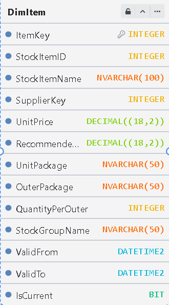
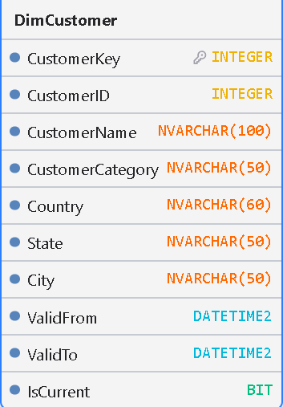
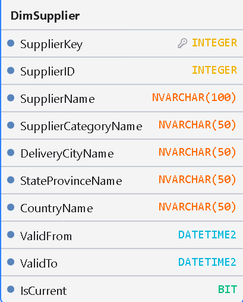
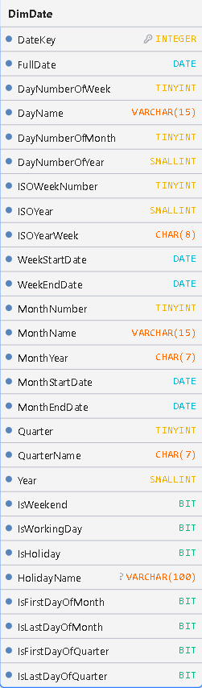
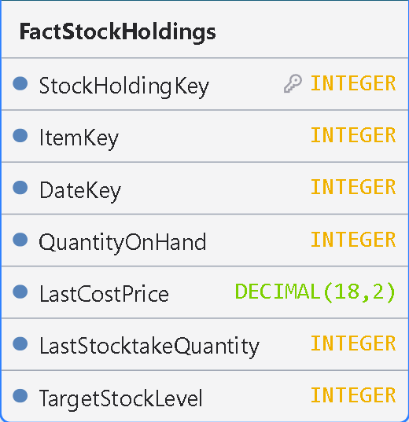
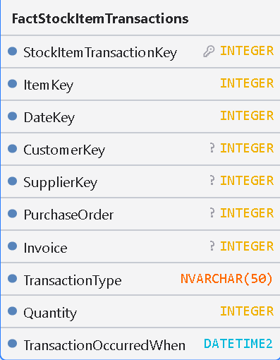
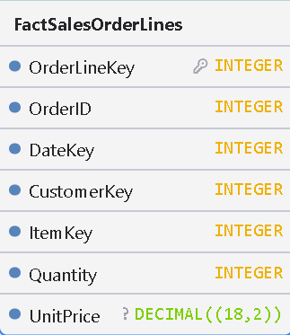
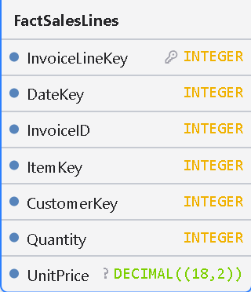
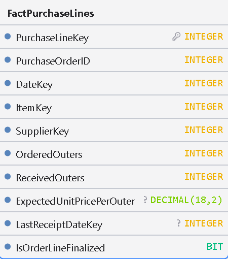

<h1>  Tablas de hechos y dimensiones  </h1>

Con el análisis de la base de datos operacional (OLTP) concluido, el desarrollo avanza hacia el diseño del modelo dimensional. Este modelo estrella (*Star Schema*) traduce las necesidades de negocio y las preguntas analíticas detectadas previamente en una estructura orientada a la consulta.   

Mientras que el OLTP prioriza la integridad transaccional, el modelo dimensional busca simplificar y acelerar el análisis de las ventas, la demanda, el inventario y el abastecimiento. Tomando como base las entidades del entorno operacional, se determinaron los procesos de negocio representados, la granularidad, las métricas y las dimensiones clave.   

Esta fase da soporte al flujo general del proyecto:

**OLTP → ETL → Data Warehouse → Power BI**

De este modo, el diseño dimensional establece las bases lógicas sobre las cuales se organizarán los datos que posteriormente poblarán el **Data Warehouse** y alimentarán los tableros de **Power BI**.

<h1>  Dimensiones  </h1>

A continuación, detallo las tablas de dimensiones que diseñé para enriquecer el modelo, definiendo los atributos clave que permitirán contextualizar el análisis sobre clientes, productos, proveedores y periodos de tiempo.

### DimItem (Dimensión de Productos)

<table>
  <tr>
    <td width="35%" align="center">
      
    </td>
    <td width="65%" valign="top">

#### Propósito y Análisis Técnico

Diseñé **DimItem** para centralizar el catálogo de productos dentro del Data Warehouse, proporcionando una estructura que permita analizar las ventas, el comportamiento de la demanda y el desempeño del inventario desde diferentes perspectivas, como categoría, empaque, precio y proveedor.

- **Claves y Relaciones:** Utilizo `ItemKey` como clave sustituta (*Surrogate Key*) para identificar cada registro dentro del Data Warehouse, mientras que `StockItemID` conserva la referencia a la clave de negocio del sistema OLTP. Además, incorporo `SupplierKey` para establecer la relación con la dimensión de proveedores (`DimSupplier`).

- **Atributos y Jerarquías:** Incluye atributos descriptivos como `StockItemName` y `StockGroupName`, que permiten identificar, clasificar y agrupar los productos en Power BI. También contempla información comercial, como `UnitPrice` y `RecommendedRetailPrice`, así como especificaciones de empaque mediante `UnitPackage`, `OuterPackage` y `QuantityPerOuter`. Estos atributos permiten enriquecer los análisis de ventas, demanda y abastecimiento.

- **Gestión del Historial (SCD Tipo 2):** Implementé una estrategia de *Slowly Changing Dimension Tipo 2* mediante los campos `ValidFrom`, `ValidTo` e `IsCurrent`. Esto permite conservar las distintas versiones de un producto cuando cambian determinados atributos, como su precio o clasificación, manteniendo la trazabilidad histórica y evitando sobrescribir información necesaria para los análisis temporales.

    </td>
  </tr>
</table>

### DimCustomer (Dimensión de Clientes)

<table>
  <tr>
    <td width="35%" align="center">
      
    </td>
    <td width="65%" valign="top">

#### Propósito y Análisis Técnico

Diseñé **DimCustomer** para consolidar el perfil de los compradores dentro del Data Warehouse, proporcionando una estructura que permita analizar el comportamiento de la demanda desde diferentes perspectivas, como el tipo de cliente y su ubicación geográfica.

- **Claves y Relaciones:** Utilizo `CustomerKey` como clave sustituta (*Surrogate Key*) para identificar cada registro dentro del Data Warehouse, mientras que `CustomerID` conserva la referencia a la clave de negocio del sistema OLTP, manteniendo la trazabilidad entre ambos sistemas.

- **Segmentación y Geografía:** Incluye atributos descriptivos como `CustomerName` y `CustomerCategoryName`, que permiten identificar y segmentar a los clientes según su categoría. Además, incorpora información geográfica mediante `DeliveryCityName`, `StateProvinceName` y `CountryName`, facilitando el análisis de ventas, distribución territorial y comportamiento de la demanda por región.

- **Gestión del Historial (SCD Tipo 2):** Implementé una estrategia de *Slowly Changing Dimension Tipo 2* mediante los campos `ValidFrom`, `ValidTo` e `IsCurrent`. Esto permite conservar las distintas versiones de un cliente cuando cambian determinados atributos, como su categoría o ubicación geográfica, manteniendo la trazabilidad histórica y evitando sobrescribir información necesaria para los análisis temporales.

    </td>
  </tr>
</table>

### DimSupplier (Dimensión de Proveedores)

<table>
  <tr>
    <td width="35%" align="center">
      
    </td>
    <td width="65%" valign="top">

#### Propósito y Análisis Técnico

Diseñé **DimSupplier** para centralizar la información de los proveedores dentro del Data Warehouse, proporcionando una estructura que permita analizar la cadena de suministro, los tiempos de entrega y la procedencia geográfica de las compras, facilitando la evaluación y el seguimiento de las relaciones comerciales con los proveedores.

- **Claves y Relaciones:** Utilizo `SupplierKey` como clave sustituta (*Surrogate Key*) para identificar cada registro dentro del Data Warehouse, mientras que `SupplierID` conserva la referencia a la clave de negocio del sistema OLTP, manteniendo la trazabilidad entre ambos sistemas.

- **Atributos y Geografía:** Incluye atributos descriptivos como `SupplierName` y `SupplierCategoryName`, que permiten identificar y agrupar a los proveedores según su categoría. Además, incorpora información geográfica mediante `DeliveryCityName`, `StateProvinceName` y `CountryName`, estableciendo una jerarquía territorial que facilita el análisis de la procedencia de las compras y la distribución logística.

- **Gestión del Historial (SCD Tipo 2):** Implementé una estrategia de *Slowly Changing Dimension Tipo 2* mediante los campos `ValidFrom`, `ValidTo` e `IsCurrent`. Esto permite conservar las distintas versiones de un proveedor cuando cambian determinados atributos, como su categoría o ubicación geográfica, manteniendo la trazabilidad histórica y evitando sobrescribir información necesaria para los análisis temporales.
    </td>
  </tr>
</table>

### DimDate (Dimensión de Tiempo)

<table>
  <tr>
    <td width="35%" align="center">
      
    </td>
    <td width="65%" valign="top">

#### Propósito y Análisis Técnico

Diseñé **DimDate** como la dimensión temporal del modelo, proporcionando una estructura que permita analizar tendencias, comportamiento de la demanda y patrones de estacionalidad en las ventas a través de diferentes periodos y niveles de agregación.

- **Origen y Construcción:** A diferencia de las dimensiones obtenidas a partir de las entidades del sistema OLTP, `DimDate` fue diseñada y construida específicamente para el Data Warehouse. Su generación es independiente de las fuentes operacionales, mediante un proceso que permite crear un calendario estructurado con los atributos temporales necesarios para los análisis históricos y de planificación.

- **Claves y Fecha:** Utilizo `DateKey` como clave sustituta (*Surrogate Key*), representada mediante un valor numérico en formato `YYYYMMDD`, mientras que `FullDate` conserva el valor de fecha estándar para facilitar las operaciones y relaciones temporales dentro del Data Warehouse.

- **Jerarquías Temporales:** Incluye atributos que permiten organizar y analizar la información en diferentes granularidades: día (`DayNumberOfWeek`, `DayName`, `DayNumberOfMonth`, `DayNumberOfYear`), semana (`ISOWeekNumber`, `ISOYear`, `ISOYearWeek`, `WeekStartDate`, `WeekEndDate`), mes (`MonthNumber`, `MonthName`, `MonthYear`, `MonthStartDate`, `MonthEndDate`), trimestre (`Quarter`, `QuarterName`) y año (`Year`). Esta estructura facilita la navegación entre periodos (*Drill-down*) y la comparación de resultados temporales en Power BI.

- **Banderas y Calendario Laboral:** Incorporé atributos lógicos como `IsWeekend`, `IsWorkingDay`, `IsHoliday` y `HolidayName` para identificar fines de semana, días laborables y festivos. Además, incluí indicadores de inicio y cierre de periodos (`IsFirstDayOfMonth`, `IsLastDayOfMonth`, `IsFirstDayOfQuarter`, `IsLastDayOfQuarter`), que permiten simplificar filtros y desarrollar cálculos analíticos relacionados con el seguimiento y comparación de periodos.

    </td>
  </tr>
</table>

<h1>  Hechos  </h1>

A continuación, presento las tablas de hechos que diseñé para registrar y cuantificar las principales operaciones del negocio, estableciendo las métricas necesarias para analizar el comportamiento de las ventas, la demanda y el desempeño del inventario. Estas tablas se relacionan con las dimensiones del modelo para facilitar el análisis de la actividad comercial y apoyar la toma de decisiones en la planificación del abastecimiento.

### FactStockHoldings (Tabla de Hechos de Inventario)

<table>
  <tr>
    <td width="35%" align="center">
      
    </td>
    <td width="65%" valign="top">

#### Propósito y Análisis Técnico

Diseñé **FactStockHoldings** para registrar y monitorear los niveles de inventario dentro del Data Warehouse, proporcionando información que permita analizar la disponibilidad de productos, la valoración del inventario y las necesidades de reabastecimiento. Esta tabla de hechos constituye una base para desarrollar análisis de desempeño del inventario y apoyar la toma de decisiones en la planeación de abastecimiento.

- **Granularidad:** Establecí una granularidad de un registro por producto y fecha, representando el estado del inventario de cada artículo en un momento determinado. Este nivel de detalle permite realizar un seguimiento temporal de las existencias y comparar su comportamiento entre diferentes periodos.

- **Claves y Relaciones:** Utilizo `StockHoldingKey` como clave primaria para identificar cada registro de la tabla de hechos, mientras que `ItemKey` y `DateKey` funcionan como claves foráneas (*Foreign Keys*), permitiendo relacionar las métricas de inventario con las dimensiones de producto (`DimItem`) y tiempo (`DimDate`).

- **Métricas y Niveles de Stock:** Almacena medidas cuantitativas fundamentales para el análisis del inventario, como `QuantityOnHand`, que representa las existencias disponibles; `LastCostPrice`, que permite estimar el valor del inventario; `LastStocktakeQuantity`, que registra la cantidad identificada en el último recuento físico; y `TargetStockLevel`, que establece el nivel objetivo de existencias para evaluar posibles necesidades de reabastecimiento.

- **Auditoría y Trazabilidad:** Incorpora `LastEditedWhen` para identificar la fecha y hora de la última modificación del registro, facilitando el seguimiento de las actualizaciones y el control de la información almacenada.

    </td>
  </tr>
</table>

### FactStockItemTransactions (Tabla de Hechos de Transacciones de Inventario)

<table>
  <tr>
    <td width="35%" align="center">
      
    </td>
    <td width="65%" valign="top">

#### Propósito y Análisis Técnico

Diseñé **FactStockItemTransactions** para registrar el historial de movimientos de inventario dentro del Data Warehouse, proporcionando trazabilidad sobre las entradas, salidas y ajustes de existencias. Esta tabla permite analizar el flujo de productos a lo largo del tiempo, identificar patrones de movimiento y generar información relevante para evaluar la rotación del inventario y apoyar la planeación de abastecimiento.

- **Granularidad:** Establecí una granularidad a nivel de transacción individual, donde cada registro representa un movimiento específico de un producto en un momento determinado. Este nivel de detalle permite identificar y analizar cada operación de inventario de manera independiente, conservando su contexto operativo y documental.

- **Claves y Relaciones:** Utilizo `StockItemTransactionKey` como clave primaria para identificar cada registro de la tabla de hechos. Además, incorporo `ItemKey` y `DateKey` como claves foráneas (*Foreign Keys*) para relacionar los movimientos con las dimensiones de producto (`DimItem`) y tiempo (`DimDate`). También incluyo `CustomerKey` y `SupplierKey` para identificar las entidades comerciales involucradas en las transacciones, cuando corresponda.

- **Atributos de Negocio y Métricas:** Incorpora referencias documentales mediante `PurchaseOrder` e `Invoice`, que permiten mantener la trazabilidad con los documentos de origen. Asimismo, utiliza `TransactionType` para clasificar la naturaleza del movimiento y `Quantity` para cuantificar el volumen de productos involucrados en cada operación. Estos atributos permiten analizar las entradas, salidas y ajustes de inventario desde diferentes perspectivas.

- **Auditoría Temporal:** Incluye `TransactionOccurredWhen` para registrar la fecha y hora exactas (*Timestamp*) en que ocurrió cada movimiento, permitiendo conservar la secuencia temporal de las operaciones y realizar análisis detallados de la actividad del inventario.

    </td>
  </tr>
</table>

### FactSalesOrderLines (Tabla de Hechos de Líneas de Ordenes de Venta)

<table>
  <tr>
    <td width="35%" align="center">
      
    </td>
    <td width="65%" valign="top">

#### Propósito y Análisis Técnico

Diseñé **FactSalesOrderLines** para almacenar el detalle transaccional de las órdenes de venta dentro del Data Warehouse, proporcionando una fuente de información que permita analizar el volumen de pedidos, el comportamiento de la demanda y el desempeño comercial. Esta tabla constituye una base para evaluar las ventas desde diferentes perspectivas, como producto, cliente y periodo, facilitando el desarrollo de indicadores y análisis en Power BI.

- **Granularidad:** Establecí una granularidad a nivel de línea de orden de venta, donde cada registro representa un producto específico solicitado dentro de una orden. Este nivel de detalle permite analizar individualmente los productos incluidos en cada pedido y conservar la relación entre las operaciones comerciales.

- **Claves y Relaciones:** Utilizo `OrderLineKey` como clave primaria para identificar cada registro de la tabla de hechos, mientras que `OrderID` conserva la referencia a la orden de venta de origen. Además, incorporo `DateKey`, `CustomerKey` e `ItemKey` como claves foráneas (*Foreign Keys*), permitiendo relacionar cada línea de venta con las dimensiones de tiempo (`DimDate`), clientes (`DimCustomer`) y productos (`DimItem`).

- **Métricas Transaccionales:** Almacena las medidas cuantitativas fundamentales para el análisis comercial, como `Quantity`, que representa la cantidad de unidades solicitadas, y `UnitPrice`, que registra el precio unitario del producto en la orden. Estas métricas permiten calcular el importe de cada línea de venta y desarrollar indicadores agregados, como volumen de ventas, ingresos por producto y comportamiento de la demanda por periodo.

    </td>
  </tr>
</table>

### FactSalesLines (Tabla de Hechos de Líneas de Facturación de Venta)

<table>
  <tr>
    <td width="35%" align="center">
      
    </td>
    <td width="65%" valign="top">

#### Propósito y Análisis Técnico

Diseñé **FactSalesLines** para almacenar el detalle transaccional de las facturas de venta dentro del Data Warehouse, proporcionando una fuente de información para analizar las ventas facturadas, los ingresos generados y el desempeño comercial de la empresa. Esta tabla permite evaluar los resultados financieros desde diferentes perspectivas, como producto, cliente y periodo, facilitando el seguimiento de los ingresos y la identificación de tendencias comerciales.

- **Granularidad:** Establecí una granularidad a nivel de línea de factura, donde cada registro representa un producto o concepto individual facturado dentro de un documento de venta. Este nivel de detalle permite analizar cada artículo facturado de manera independiente y conservar su relación con la factura de origen.

- **Claves y Relaciones:** Utilizo `InvoiceLineKey` como clave primaria para identificar cada registro de la tabla de hechos, mientras que `InvoiceID` conserva la referencia a la factura de origen. Además, incorporo `DateKey`, `ItemKey` y `CustomerKey` como claves foráneas (*Foreign Keys*), permitiendo relacionar cada línea facturada con las dimensiones de tiempo (`DimDate`), productos (`DimItem`) y clientes (`DimCustomer`).

- **Métricas Financieras:** Almacena las medidas cuantitativas fundamentales para el análisis de ventas, como `Quantity`, que representa la cantidad de unidades facturadas, y `UnitPrice`, que registra el precio unitario aplicado en la transacción. Estas métricas permiten calcular los importes por línea de factura y desarrollar indicadores financieros y comerciales, como ingresos por producto, facturación por cliente y evolución de las ventas por periodo en Power BI.

    </td>
  </tr>
</table>

### FactPurchaseLines (Tabla de Hechos de Líneas de Órdenes de Compra)

<table>
  <tr>
    <td width="35%" align="center">
      
    </td>
    <td width="65%" valign="top">

#### Propósito y Análisis Técnico

Diseñé **FactPurchaseLines** para almacenar el detalle transaccional de las órdenes de compra dentro del Data Warehouse, proporcionando información que permita analizar el proceso de abastecimiento, las compras de importación y el desempeño de los proveedores. Esta tabla facilita el seguimiento de las cantidades solicitadas y recibidas, los costos de adquisición y el cumplimiento de los compromisos de entrega, proporcionando una base para desarrollar análisis de abastecimiento y planeación de inventario.

- **Granularidad:** Establecí una granularidad a nivel de línea de orden de compra, donde cada registro representa un producto específico solicitado a un proveedor dentro de una orden. Este nivel de detalle permite realizar el seguimiento individual de cada producto comprado y conservar su relación con la orden de origen.

- **Claves y Relaciones:** Utilizo `PurchaseLineKey` como clave primaria para identificar cada registro de la tabla de hechos, mientras que `PurchaseOrderID` conserva la referencia a la orden de compra de origen. Además, incorporo `DateKey`, `ItemKey` y `SupplierKey` como claves foráneas (*Foreign Keys*), permitiendo relacionar cada línea de compra con las dimensiones de tiempo (`DimDate`), productos (`DimItem`) y proveedores (`DimSupplier`). También incluyo `LastReceiptDateKey` para identificar la fecha de la última recepción física de mercancía y facilitar el análisis temporal del abastecimiento.

- **Métricas de Compra y Cumplimiento:** Almacena medidas cuantitativas fundamentales para el seguimiento de las compras, como `OrderedOuters`, que representa la cantidad de empaques solicitados; `ReceivedOuters`, que registra los empaques recibidos; y `ExpectedUnitPricePerOuter`, que establece el precio esperado por empaque. Estas métricas permiten comparar las cantidades solicitadas frente a las recibidas, analizar los costos de adquisición y evaluar el nivel de cumplimiento de los proveedores.

- **Estado de la Línea:** Incorpora el indicador lógico `IsOrderLineFinalized` para identificar si una línea de orden de compra ha sido completada o continúa pendiente de recepción. Este atributo facilita la identificación de compromisos de abastecimiento pendientes y el seguimiento del estado de las compras.

    </td>
  </tr>
</table>
