# Implementación física y construcción del Data Warehouse

Esta sección documenta el proceso de implementación física del Data Warehouse de KireImports, tomando como referencia el diseño dimensional y la arquitectura de tipo constelación definidos en los apartados anteriores. En esta etapa, los modelos dimensionales previamente diseñados se materializan mediante la creación de las estructuras físicas de almacenamiento en Microsoft SQL Server, utilizando SQL (Structured Query Language) como lenguaje para la definición y construcción de la base de datos.

La implementación contempla la creación de las tablas de dimensiones y hechos, estableciendo sus respectivos tipos de datos, claves primarias, claves foráneas, restricciones de integridad y relaciones, con el propósito de garantizar la consistencia estructural y referencial del modelo dimensional.

Asimismo, se definen los elementos necesarios para reproducir la arquitectura dimensional diseñada, considerando la implementación de las dimensiones compartidas, la estructura de las tablas de hechos y los mecanismos de identificación y relación entre sus registros.

Finalmente, se obtiene una base de datos estructurada en Microsoft SQL Server, conforme al modelo dimensional de KireImports y preparada para recibir, almacenar y organizar la información proveniente de los procesos de extracción, transformación y carga (ETL/ELT), que serán desarrollados en la siguiente unidad del proyecto.

# 1. Creación del Data Warehouse

## 1.1. Descripción

Se creó la base de datos kireimportsDW en SQL Server,
la cual servirá como estructura principal de almacenamiento
para implementar el modelo dimensional de KireImports.

## 1.2. Implementación SQL

```sql
CREATE DATABASE kireimportsDW;
GO
```

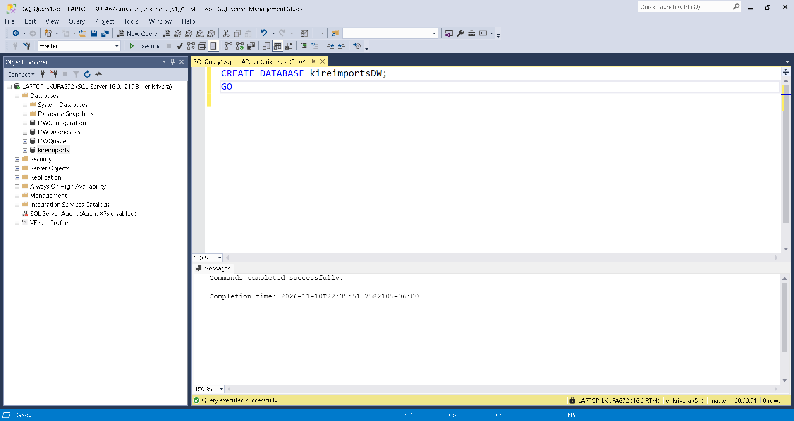

## 1.3. Verificación de la implementación

```sql
SELECT
    name AS DatabaseName,
    database_id AS DatabaseID,
    create_date AS CreationDate,
    state_desc AS DatabaseStatus
FROM sys.databases
WHERE name = 'kireimportsDW';
GO
```
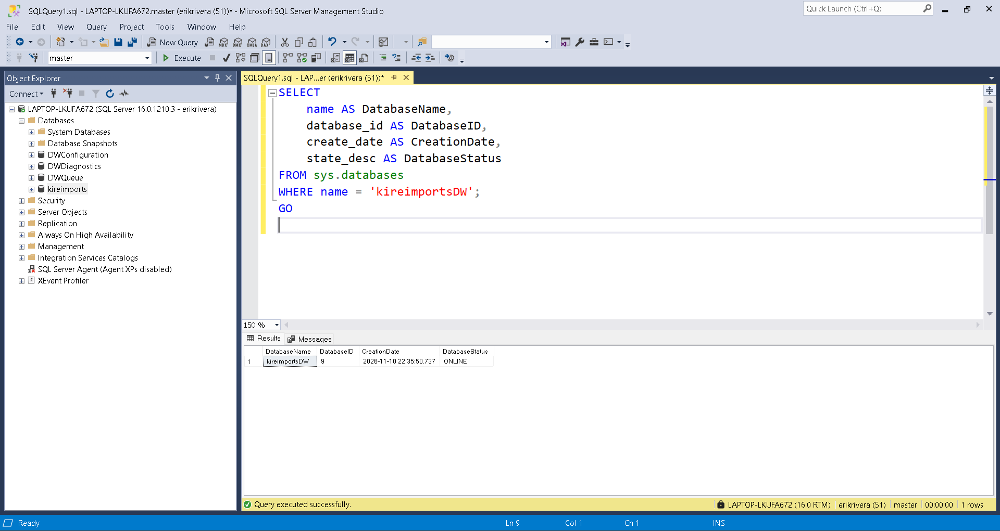

# 2. Creación de esquemas de organización

## 2.1. Descripción

Se establecieron dos esquemas dentro de la base de datos KireImportsDW para organizar físicamente las estructuras del Data Warehouse.

El esquema `dim` almacenará las tablas dimensionales, incluyendo las dimensiones conformadas compartidas entre los diferentes procesos de negocio.

El esquema `fact` almacenará las tablas de hechos correspondientes a los procesos de negocio de KireImports, permitiendo mantener una separación lógica entre las dimensiones y los datos transaccionales y analíticos.

## 2.2. Implementación SQL

```sql
-- Seleccionar la base de datos del Data Warehouse

USE [kireimportsDW];
GO

-- Crear esquema dimensional

CREATE SCHEMA dim AUTHORIZATION dbo;
GO

-- Crear esquema de hechos

CREATE SCHEMA fact AUTHORIZATION dbo;
GO
```

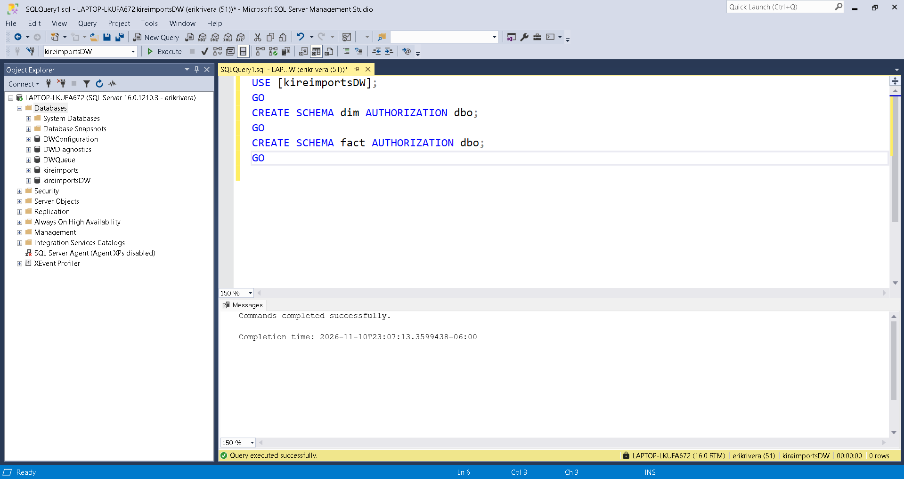

## 2.3. Verificación de la implementación

```sql
SELECT
    name AS SchemaName,
    schema_id AS SchemaID,
    USER_NAME(principal_id) AS SchemaOwner
FROM sys.schemas
WHERE name IN ('dim', 'fact')
ORDER BY name;
GO
```
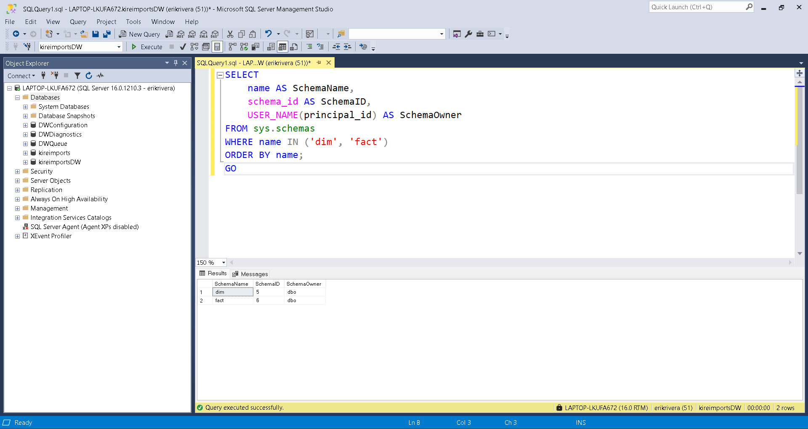

# 3. Implementación de las tablas de dimensiones

## 3.1. Descripción

Se implementarán físicamente las cuatro tablas dimensionales del Data Warehouse de KireImports en SQL Server, tomando como referencia el modelo dimensional integrado (esquema constelación) definido durante la etapa de diseño.

Las dimensiones se almacenarán dentro del esquema dim y proporcionarán los atributos descriptivos necesarios para analizar los diferentes procesos de negocio de inventarios, demanda de venta, ventas facturadas y abastecimiento.

La implementación contempla la definición de claves sustitutas (Surrogate Keys), claves de negocio (Business Keys), tipos de datos, restricciones de integridad y atributos para la gestión de cambios históricos mediante Slowly Changing Dimensions Tipo 2 (SCD Type 2), en las dimensiones correspondientes.

Las dimensiones conformadas se implementarán como estructuras únicas y compartidas entre las diferentes tablas de hechos, evitando la duplicación de información y manteniendo la consistencia del modelo dimensional.

Las tablas dimensionales que se implementarán son:
- DimDate: dimensión temporal.
- DimItem: dimensión de productos.
- DimSupplier: dimensión de proveedores.
- DimCustomer: dimensión de clientes.

## 3.2. Implementación SQL

La implementación se realizará mediante instrucciones CREATE TABLE dentro del esquema dim, respetando las estructuras definidas en el modelo dimensional.

## 3.2.1. Creación de DimDate
Dimensión temporal que permitirá analizar la información mediante diferentes niveles de granularidad: días, semanas, meses, trimestres y años.

```sql
-- KireImports Data Warehouse
-- Dimension: DimDate
USE [kireimportsDW];
GO

CREATE TABLE dim.DimDate (
    DateKey INT NOT NULL,
    FullDate DATE NOT NULL,
    DayNumberOfWeek TINYINT NOT NULL,
    DayName VARCHAR(15) NOT NULL,
    DayNumberOfMonth TINYINT NOT NULL,
    DayNumberOfYear SMALLINT NOT NULL,
    ISOWeekNumber TINYINT NOT NULL,
    ISOYear SMALLINT NOT NULL,
    ISOYearWeek CHAR(8) NOT NULL,
    WeekStartDate DATE NOT NULL,
    WeekEndDate DATE NOT NULL,
    MonthNumber TINYINT NOT NULL,
    MonthName VARCHAR(15) NOT NULL,
    MonthYear CHAR(7) NOT NULL,
    MonthStartDate DATE NOT NULL,
    MonthEndDate DATE NOT NULL,
    Quarter TINYINT NOT NULL,
    QuarterName CHAR(7) NOT NULL,
    Year SMALLINT NOT NULL,
    IsWeekend BIT NOT NULL,
    IsWorkingDay BIT NOT NULL,
    IsHoliday BIT NOT NULL,
    HolidayName VARCHAR(100) NULL,
    IsFirstDayOfMonth BIT NOT NULL,
    IsLastDayOfMonth BIT NOT NULL,
    IsFirstDayOfQuarter BIT NOT NULL,
    IsLastDayOfQuarter BIT NOT NULL,

    CONSTRAINT PK_DimDate
        PRIMARY KEY (DateKey),

    CONSTRAINT UQ_DimDate_FullDate
        UNIQUE (FullDate)
);
GO
```
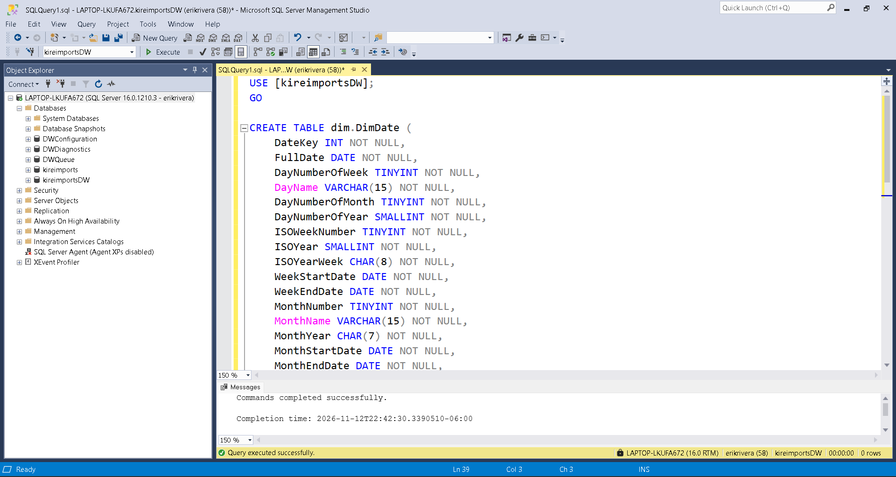

## 3.2.2. Creación de DimItem
Dimensión de productos que almacenará los atributos descriptivos y comerciales de los artículos.

Se incorporan los campos ValidFrom, ValidTo e IsCurrent para gestionar el historial de cambios mediante SCD Tipo 2.

```sql
-- =============================================
-- KireImports Data Warehouse
-- Dimension: DimItem
-- =============================================

CREATE TABLE dim.DimItem (
    ItemKey INT IDENTITY(1,1) NOT NULL,
    StockItemID INT NOT NULL,
    StockItemName NVARCHAR(100) NOT NULL,
    UnitPrice DECIMAL(18,2) NOT NULL,
    RecommendedRetailPrice DECIMAL(18,2) NOT NULL,
    UnitPackage NVARCHAR(50) NOT NULL,
    OuterPackage NVARCHAR(50) NOT NULL,
    QuantityPerOuter INT NOT NULL,
    StockGroupName NVARCHAR(50) NOT NULL,
    ValidFrom DATETIME2 NOT NULL,
    ValidTo DATETIME2 NOT NULL,
    IsCurrent BIT NOT NULL,

    CONSTRAINT PK_DimItem
        PRIMARY KEY (ItemKey),

    CONSTRAINT CK_DimItem_ValidityPeriod
        CHECK (ValidFrom < ValidTo)
);
GO

-- Garantiza una única versión actual por ítem

CREATE UNIQUE INDEX UQ_DimItem_Current
ON dim.DimItem (StockItemID)
WHERE IsCurrent = 1;
GO
```
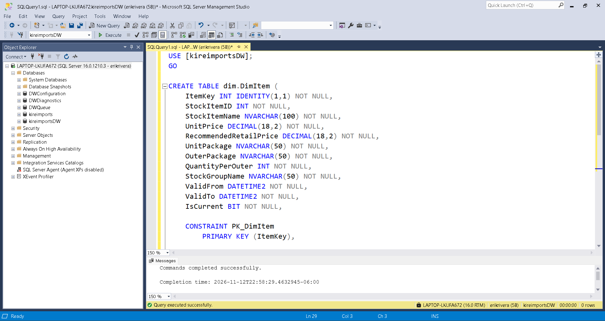

## 3.2.3. Creación de DimSupplier
Dimensión de proveedores que almacenará información descriptiva, de clasificación y ubicación geográfica.

Se incorporan los atributos de control histórico para conservar las diferentes versiones de cada proveedor.

```sql
-- =============================================
-- KireImports Data Warehouse
-- Dimension: DimSupplier
-- =============================================

CREATE TABLE dim.DimSupplier (
    SupplierKey INT IDENTITY(1,1) NOT NULL,
    SupplierID INT NOT NULL,
    SupplierName NVARCHAR(100) NOT NULL,
    SupplierCategoryName NVARCHAR(50) NOT NULL,
    DeliveryCityName NVARCHAR(50) NOT NULL,
    StateProvinceName NVARCHAR(50) NOT NULL,
    CountryName NVARCHAR(50) NOT NULL,
    ValidFrom DATETIME2 NOT NULL,
    ValidTo DATETIME2 NOT NULL,
    IsCurrent BIT NOT NULL,

    CONSTRAINT PK_DimSupplier
        PRIMARY KEY (SupplierKey),

    CONSTRAINT CK_DimSupplier_ValidityPeriod
        CHECK (ValidFrom < ValidTo)
);
GO

-- Garantiza una única versión actual por proveedor

CREATE UNIQUE INDEX UQ_DimSupplier_Current
ON dim.DimSupplier (SupplierID)
WHERE IsCurrent = 1;
GO
```
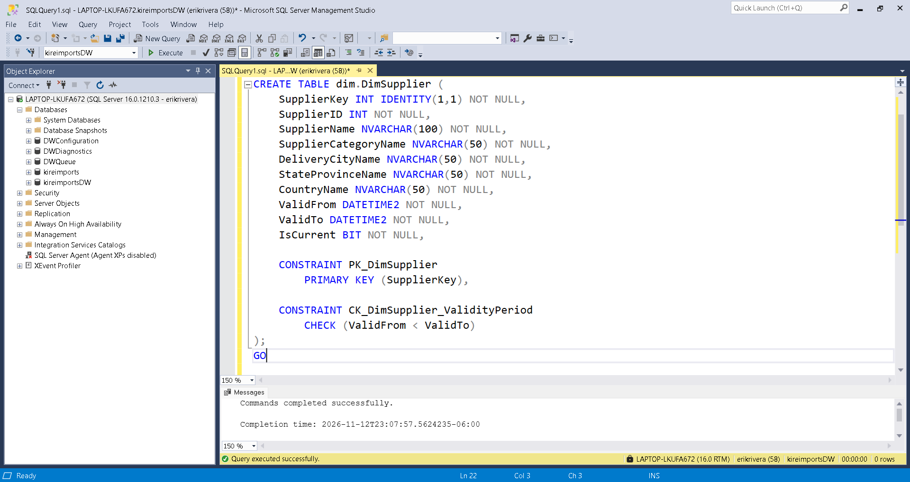

## 3.2.4. Creación de DimCustomer
Dimensión de clientes que almacenará información descriptiva, geográfica y de clasificación de los clientes.

Al igual que las dimensiones de productos y proveedores, implementará el seguimiento histórico mediante SCD Tipo 2.

```sql
-- =============================================
-- KireImports Data Warehouse
-- Dimension: DimCustomer
-- =============================================

CREATE TABLE dim.DimCustomer (
    CustomerKey INT IDENTITY(1,1) NOT NULL,
    CustomerID INT NOT NULL,
    CustomerName NVARCHAR(100) NOT NULL,
    CustomerCategory NVARCHAR(50) NOT NULL,
    Country NVARCHAR(60) NOT NULL,
    State NVARCHAR(50) NOT NULL,
    City NVARCHAR(50) NOT NULL,
    ValidFrom DATETIME2 NOT NULL,
    ValidTo DATETIME2 NOT NULL,
    IsCurrent BIT NOT NULL,

    CONSTRAINT PK_DimCustomer
        PRIMARY KEY (CustomerKey),

    CONSTRAINT CK_DimCustomer_ValidityPeriod
        CHECK (ValidFrom < ValidTo)
);
GO

-- Garantiza una única versión actual por cliente

CREATE UNIQUE INDEX UQ_DimCustomer_Current
ON dim.DimCustomer (CustomerID)
WHERE IsCurrent = 1;
GO
```

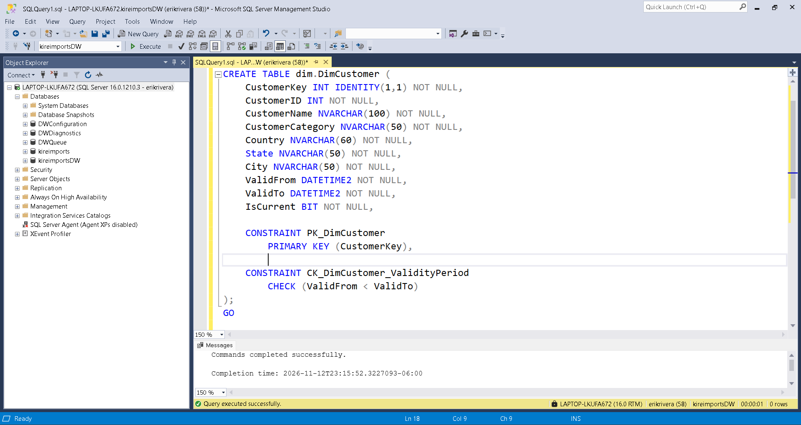

## 3.3. Verificación de la implementación
Una vez creadas las cuatro dimensiones, ejecutaremos consultas para comprobar que las estructuras físicas se hayan implementado correctamente.
## 3.3.1. Verificación de existencia de las dimensiones
```sql
-- =============================================
-- Verificación de tablas de dimensiones
-- =============================================

SELECT
    SCHEMA_NAME(t.schema_id) AS SchemaName,
    t.name AS TableName,
    t.create_date AS CreationDate
FROM sys.tables t
WHERE t.schema_id = SCHEMA_ID('dim')
ORDER BY t.name;
GO
```
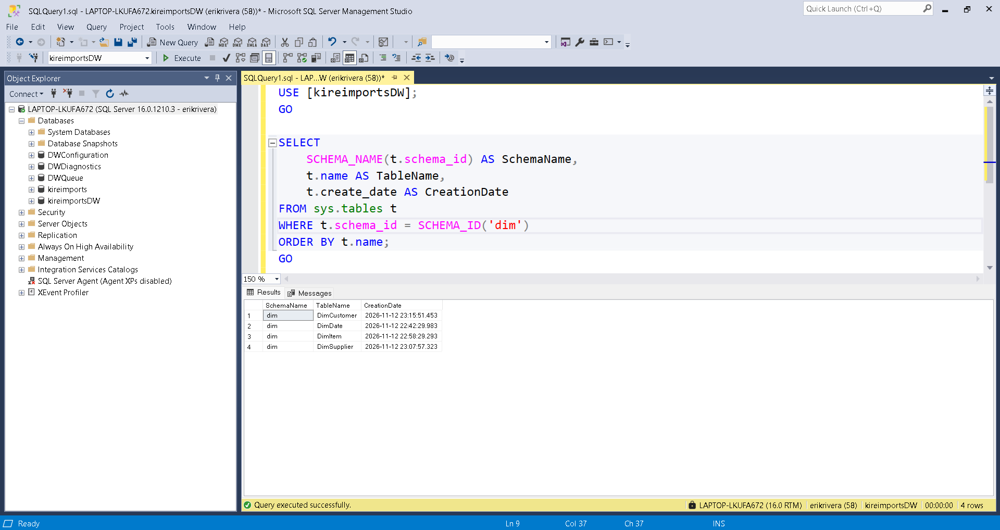

## 3.3.2. Verificación de columnas y tipos de datos

```sql

-- =============================================
-- Verificación de columnas de dimensión
-- =============================================

SELECT
    t.name AS TableName,
    c.column_id AS ColumnID,
    c.name AS ColumnName,
    TYPE_NAME(c.user_type_id) AS DataType,
    c.max_length AS MaxLength,
    c.is_nullable AS IsNullable,
    c.is_identity AS IsIdentity
FROM sys.tables t
INNER JOIN sys.columns c
    ON t.object_id = c.object_id
WHERE t.schema_id = SCHEMA_ID('dim')
ORDER BY
    t.name,
    c.column_id;
GO

```
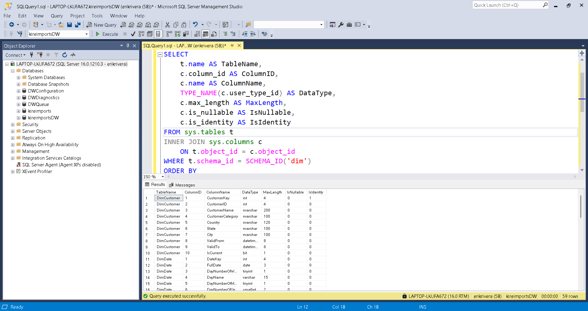

## 3.3.3. Verificación de claves primarias e índices
```sql

-- =============================================
-- Verificación de restricciones de dimensiones
-- =============================================

SELECT
    t.name AS TableName,
    i.name AS IndexName,
    i.type_desc AS IndexType,
    i.is_primary_key AS IsPrimaryKey,
    i.is_unique AS IsUnique,
    i.filter_definition AS FilterDefinition
FROM sys.tables t
INNER JOIN sys.indexes i
    ON t.object_id = i.object_id
WHERE t.schema_id = SCHEMA_ID('dim')
  AND i.index_id > 0
ORDER BY
    t.name,
    i.index_id;
GO
```
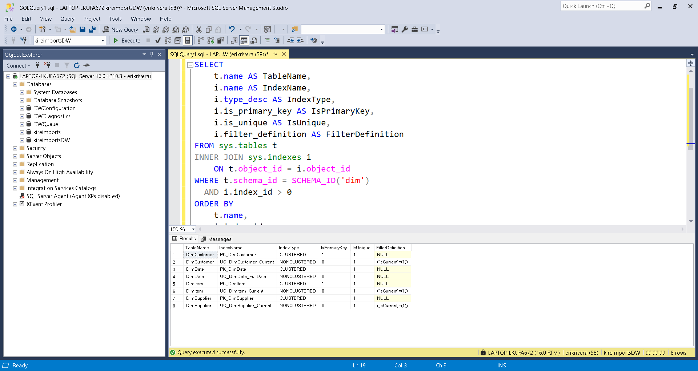

## 4. Implementación de las tablas de hechos
## 4.1. Descripción
Se implementarán físicamente las cinco tablas de hechos del Data Warehouse de KireImports en SQL Server, tomando como referencia los modelos dimensionales por proceso de negocio definidos durante la etapa de diseño.

Las tablas de hechos se almacenarán dentro del esquema fact y contendrán las medidas e identificadores necesarios para analizar los procesos de inventarios, demanda de venta, ventas facturadas y abastecimiento.

La implementación contempla la definición de claves primarias (Primary Keys), claves foráneas (Foreign Keys), restricciones de unicidad, tipos de datos y relaciones con las dimensiones conformadas del Data Warehouse.

Asimismo, se establecerá la granularidad de cada tabla de hechos, definiendo el nivel de detalle que representa cada registro y garantizando la correspondencia con el diseño dimensional previamente desarrollado.

Las tablas de hechos que se implementarán son:
- FactStockHoldings: almacena información de existencias de inventario mediante registros de seguimiento periódico.
- FactStockItemTransactions: registra los movimientos y transacciones asociados a los artículos del inventario.
- FactSalesOrderLines: almacena información de las líneas de pedidos de venta.
- FactSalesLines: registra las líneas de venta facturadas.
- FactPurchaseLines: almacena información de las líneas de órdenes de compra y recepción de mercancías.

## 4.2. Implementación SQL
La implementación se realizará mediante instrucciones CREATE TABLE dentro del esquema fact, respetando las estructuras, atributos, tipos de datos y claves establecidos en el modelo dimensional.
## 4.2.1. Creación de FactStockHoldings
Esta tabla almacenará información de las existencias de inventario mediante fotografías periódicas (Periodic Snapshot).

Su granularidad será de un registro por artículo y fecha de captura, permitiendo analizar la evolución de las existencias y los niveles de inventario a través del tiempo.

```sql
-- =============================================
-- KireImports Data Warehouse
-- Fact Table: FactStockHoldings
-- =============================================

USE [kireimportsDW];
GO

CREATE TABLE fact.FactStockHoldings (
    StockHoldingKey INT IDENTITY(1,1) NOT NULL,
    ItemKey INT NOT NULL,
    DateKey INT NOT NULL,
    QuantityOnHand INT NOT NULL,
    LastCostPrice DECIMAL(18,2) NOT NULL,
    LastStocktakeQuantity INT NOT NULL,
    TargetStockLevel INT NOT NULL,

    CONSTRAINT PK_FactStockHoldings
        PRIMARY KEY (StockHoldingKey),

    CONSTRAINT UQ_FactStockHoldings_ItemKey_DateKey
        UNIQUE (ItemKey, DateKey)
);
GO
```
La restricción UNIQUE (ItemKey, DateKey) garantiza que no existan registros duplicados para un mismo artículo en una misma fecha de captura.

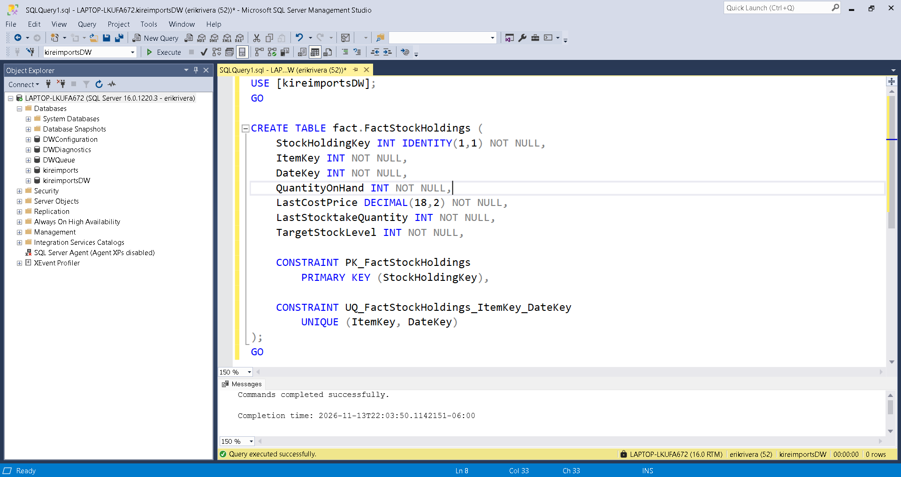

## 4.2.2. Creación de FactStockItemTransactions
Esta tabla registrará los movimientos y transacciones de los artículos del inventario, permitiendo analizar sus cantidades, tipos de movimiento y relaciones con clientes y proveedores.

Su granularidad será de un registro por cada transacción individual de inventario.
```sql
-- =============================================
-- KireImports Data Warehouse
-- Fact Table: FactStockItemTransactions
-- =============================================

CREATE TABLE fact.FactStockItemTransactions (
    StockItemTransactionKey INT NOT NULL,
    ItemKey INT NOT NULL,
    DateKey INT NOT NULL,
    CustomerKey INT NULL,
    SupplierKey INT NULL,
    PurchaseOrder INT NULL,
    Invoice INT NULL,
    TransactionType NVARCHAR(50) NOT NULL,
    Quantity INT NOT NULL,
    TransactionOccurredWhen DATETIME2 NOT NULL,

    CONSTRAINT PK_FactStockItemTransactions
        PRIMARY KEY (StockItemTransactionKey)
);
GO
```
CustomerKey y SupplierKey permiten valores nulos porque no todas las transacciones de inventario necesariamente están asociadas a un cliente o proveedor.

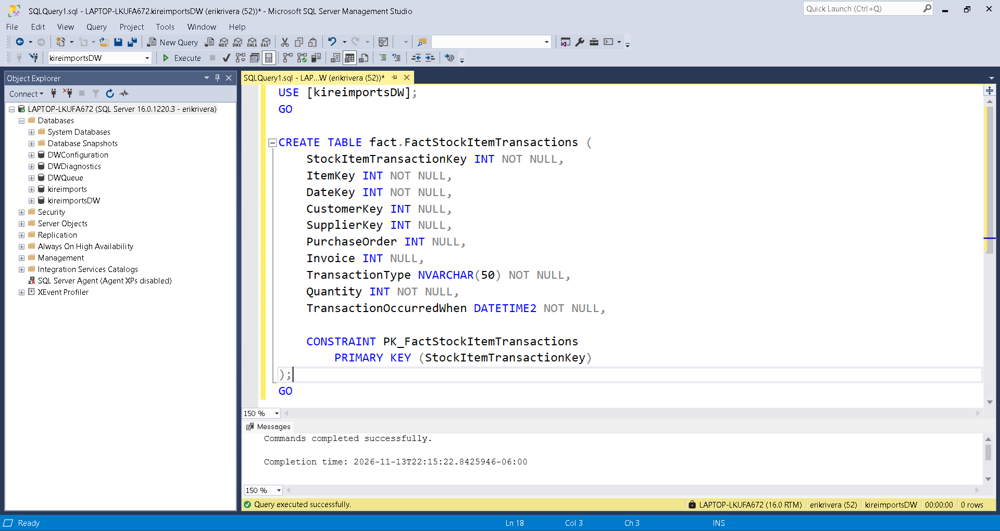

## 4.2.3. Creación de FactSalesOrderLines
Esta tabla registrará la demanda de productos originada por las órdenes de venta, permitiendo analizar con precisión las cantidades demandadas, los volúmenes de requerimiento y los precios asociados a los artículos. 

Su granularidad será de un registro por cada línea de detalle de pedido de venta.

```sql
-- =============================================
-- KireImports Data Warehouse
-- Fact Table: FactSalesOrderLines
-- =============================================

CREATE TABLE fact.FactSalesOrderLines (
    OrderLineKey INT NOT NULL,
    OrderID INT NOT NULL,
    DateKey INT NOT NULL,
    CustomerKey INT NOT NULL,
    ItemKey INT NOT NULL,
    Quantity INT NOT NULL,
    UnitPrice DECIMAL(18,2) NULL,

    CONSTRAINT PK_FactSalesOrderLines
        PRIMARY KEY (OrderLineKey)
);
GO
```
OrderID permite identificar el pedido al que pertenece cada línea, mientras que OrderLineKey identifica individualmente cada registro dentro de la tabla de hechos.

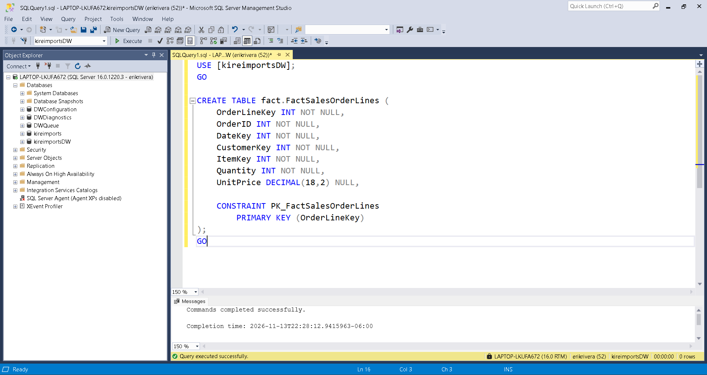

## 4.2.4. Creación de FactSalesLines
Esta tabla almacenará las líneas de venta facturadas, permitiendo analizar las cantidades vendidas y los precios asociados a las transacciones comerciales completadas mediante facturación.

Su granularidad será de un registro por cada línea de factura de venta.
```sql
-- =============================================
-- KireImports Data Warehouse
-- Fact Table: FactSalesLines
-- =============================================

CREATE TABLE fact.FactSalesLines (
    InvoiceLineKey INT NOT NULL,
    InvoiceID INT NOT NULL,
    OrderID INT NOT NULL,
    DateKey INT NOT NULL,
    ItemKey INT NOT NULL,
    CustomerKey INT NOT NULL,
    Quantity INT NOT NULL,
    UnitPrice DECIMAL(18,2) NULL,

    CONSTRAINT PK_FactSalesLines
        PRIMARY KEY (InvoiceLineKey)
);
GO
```
Se conservan tanto InvoiceID como OrderID para permitir relacionar las ventas facturadas con sus respectivos documentos comerciales de origen.


## 4.2.5. Creación de FactPurchaseLines
Esta tabla almacenará información de las líneas de órdenes de compra, permitiendo analizar las cantidades solicitadas, recibidas y los precios esperados de adquisición.

Su granularidad será de un registro por cada línea de orden de compra.

```sql
-- KireImports Data Warehouse
-- Fact Table: FactPurchaseLines
-- =============================================

CREATE TABLE fact.FactPurchaseLines (
    PurchaseLineKey INT NOT NULL,
    PurchaseOrderID INT NOT NULL,
    DateKey INT NOT NULL,
    ItemKey INT NOT NULL,
    SupplierKey INT NOT NULL,
    OrderedOuters INT NOT NULL,
    ReceivedOuters INT NOT NULL,
    ExpectedUnitPricePerOuter DECIMAL(18,2) NULL,
    LastReceiptDateKey INT NULL,
    IsOrderLineFinalized BIT NOT NULL,

    CONSTRAINT PK_FactPurchaseLines
        PRIMARY KEY (PurchaseLineKey)
);
GO
```
LastReceiptDateKey permite valores nulos porque una línea de compra puede no tener todavía una fecha de última recepción registrada.


## 4.2.6. Creación de claves foráneas y relaciones dimensionales
Una vez creadas las cinco tablas de hechos, estableceremos las relaciones con las dimensiones correspondientes mediante restricciones FOREIGN KEY.

Estas relaciones permitirán mantener la integridad referencial entre las tablas de hechos y las dimensiones del Data Warehouse.

De acuerdo con el modelo dimensional, las relaciones serán las siguientes:

| Tabla de hechos           | Dimensión   | Clave relacionada  |
| ------------------------- | ----------- | ------------------ |
| FactStockHoldings         | DimItem     | ItemKey            |
| FactStockHoldings         | DimDate     | DateKey            |
| FactStockItemTransactions | DimItem     | ItemKey            |
| FactStockItemTransactions | DimDate     | DateKey            |
| FactStockItemTransactions | DimCustomer | CustomerKey        |
| FactStockItemTransactions | DimSupplier | SupplierKey        |
| FactSalesOrderLines       | DimDate     | DateKey            |
| FactSalesOrderLines       | DimCustomer | CustomerKey        |
| FactSalesOrderLines       | DimItem     | ItemKey            |
| FactSalesLines            | DimDate     | DateKey            |
| FactSalesLines            | DimItem     | ItemKey            |
| FactSalesLines            | DimCustomer | CustomerKey        |
| FactPurchaseLines         | DimDate     | DateKey            |
| FactPurchaseLines         | DimItem     | ItemKey            |
| FactPurchaseLines         | DimSupplier | SupplierKey        |
| FactPurchaseLines         | DimDate     | LastReceiptDateKey |

```sql

-- =============================================
-- KireImports Data Warehouse
-- Fact Tables: Foreign Key Constraints
-- =============================================

USE [kireimportsDW];
GO

-- FactStockHoldings

ALTER TABLE fact.FactStockHoldings
ADD CONSTRAINT FK_FactStockHoldings_DimItem
FOREIGN KEY (ItemKey)
REFERENCES dim.DimItem (ItemKey);

ALTER TABLE fact.FactStockHoldings
ADD CONSTRAINT FK_FactStockHoldings_DimDate
FOREIGN KEY (DateKey)
REFERENCES dim.DimDate (DateKey);
GO

-- FactStockItemTransactions

ALTER TABLE fact.FactStockItemTransactions
ADD CONSTRAINT FK_FactStockItemTransactions_DimItem
FOREIGN KEY (ItemKey)
REFERENCES dim.DimItem (ItemKey);

ALTER TABLE fact.FactStockItemTransactions
ADD CONSTRAINT FK_FactStockItemTransactions_DimDate
FOREIGN KEY (DateKey)
REFERENCES dim.DimDate (DateKey);

ALTER TABLE fact.FactStockItemTransactions
ADD CONSTRAINT FK_FactStockItemTransactions_DimCustomer
FOREIGN KEY (CustomerKey)
REFERENCES dim.DimCustomer (CustomerKey);

ALTER TABLE fact.FactStockItemTransactions
ADD CONSTRAINT FK_FactStockItemTransactions_DimSupplier
FOREIGN KEY (SupplierKey)
REFERENCES dim.DimSupplier (SupplierKey);
GO

-- FactSalesOrderLines

ALTER TABLE fact.FactSalesOrderLines
ADD CONSTRAINT FK_FactSalesOrderLines_DimDate
FOREIGN KEY (DateKey)
REFERENCES dim.DimDate (DateKey);

ALTER TABLE fact.FactSalesOrderLines
ADD CONSTRAINT FK_FactSalesOrderLines_DimCustomer
FOREIGN KEY (CustomerKey)
REFERENCES dim.DimCustomer (CustomerKey);

ALTER TABLE fact.FactSalesOrderLines
ADD CONSTRAINT FK_FactSalesOrderLines_DimItem
FOREIGN KEY (ItemKey)
REFERENCES dim.DimItem (ItemKey);
GO

-- FactSalesLines

ALTER TABLE fact.FactSalesLines
ADD CONSTRAINT FK_FactSalesLines_DimDate
FOREIGN KEY (DateKey)
REFERENCES dim.DimDate (DateKey);

ALTER TABLE fact.FactSalesLines
ADD CONSTRAINT FK_FactSalesLines_DimItem
FOREIGN KEY (ItemKey)
REFERENCES dim.DimItem (ItemKey);

ALTER TABLE fact.FactSalesLines
ADD CONSTRAINT FK_FactSalesLines_DimCustomer
FOREIGN KEY (CustomerKey)
REFERENCES dim.DimCustomer (CustomerKey);
GO

-- FactPurchaseLines

ALTER TABLE fact.FactPurchaseLines
ADD CONSTRAINT FK_FactPurchaseLines_DimDate
FOREIGN KEY (DateKey)
REFERENCES dim.DimDate (DateKey);

ALTER TABLE fact.FactPurchaseLines
ADD CONSTRAINT FK_FactPurchaseLines_DimItem
FOREIGN KEY (ItemKey)
REFERENCES dim.DimItem (ItemKey);

ALTER TABLE fact.FactPurchaseLines
ADD CONSTRAINT FK_FactPurchaseLines_DimSupplier
FOREIGN KEY (SupplierKey)
REFERENCES dim.DimSupplier (SupplierKey);

ALTER TABLE fact.FactPurchaseLines
ADD CONSTRAINT FK_FactPurchaseLines_LastReceiptDate
FOREIGN KEY (LastReceiptDateKey)
REFERENCES dim.DimDate (DateKey);
GO

```

-   Se utiliza `ALTER TABLE` para incorporar las relaciones después de crear las tablas.
-   Las claves foráneas apuntan a las claves sustitutas de las dimensiones.
-   Las relaciones con `CustomerKey`, `SupplierKey` y `LastReceiptDateKey` permiten valores nulos cuando así lo establece el diseño.
-   SQL Server utiliza `NO ACTION` como comportamiento predeterminado para las operaciones de eliminación y actualización cuando no se especifica otra acción. Por tanto, se conserva el comportamiento definido en tu modelo.
-   `LastReceiptDateKey` establece una segunda relación de `FactPurchaseLines` con `DimDate`, esta vez para representar la fecha de última recepción.

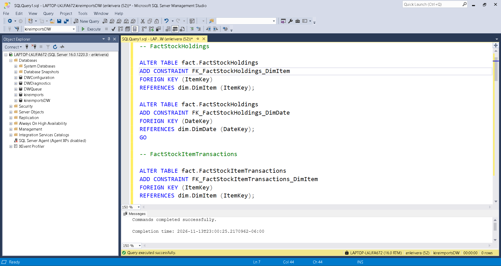

## 4.3. Verificación de la implementación
Una vez creadas las tablas de hechos y sus relaciones, realizaremos consultas al catálogo del sistema de SQL Server para comprobar que las estructuras físicas se hayan implementado correctamente.

## 4.3.1. Verificación de existencia de las tablas de hechos

```sql
-- =============================================
-- Verificación tablas de hechos 
-- =============================================

SELECT
    SCHEMA_NAME(t.schema_id) AS SchemaName,
    t.name AS TableName,
    t.create_date AS CreationDate
FROM sys.tables t
WHERE t.schema_id = SCHEMA_ID('fact')
ORDER BY t.name;
GO
```

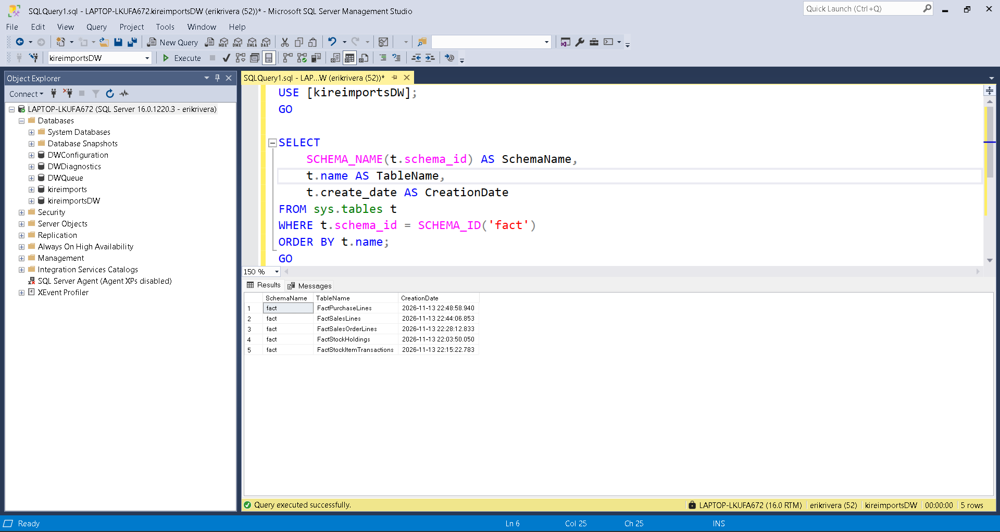

## 4.3.2. Verificación de columnas y tipos de datos

```sql
-- =============================================
-- Verificación de columnas de tablas de hechos
-- =============================================

SELECT
    t.name AS TableName,
    c.column_id AS ColumnID,
    c.name AS ColumnName,
    TYPE_NAME(c.user_type_id) AS DataType,
    c.max_length AS MaxLength,
    c.is_nullable AS IsNullable,
    c.is_identity AS IsIdentity
FROM sys.tables t
INNER JOIN sys.columns c
    ON t.object_id = c.object_id
WHERE t.schema_id = SCHEMA_ID('fact')
ORDER BY
    t.name,
    c.column_id;
GO
```
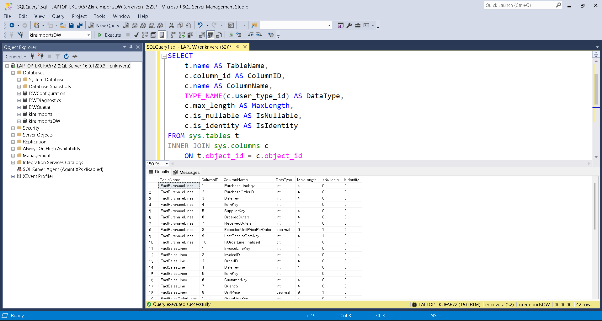

## 4.3.3. Verificación de claves foráneas

```sql
-- =============================================
-- Verificación de claves foráneas de tablas de hechos
-- =============================================

SELECT
    OBJECT_NAME(fk.parent_object_id) AS FactTable,
    fk.name AS ForeignKeyName,
    COL_NAME(
        fkc.parent_object_id,
        fkc.parent_column_id
    ) AS FactColumn,
    OBJECT_SCHEMA_NAME(fk.referenced_object_id)
        + '.' +
    OBJECT_NAME(fk.referenced_object_id) AS ReferencedTable,
    COL_NAME(
        fkc.referenced_object_id,
        fkc.referenced_column_id
    ) AS ReferencedColumn
FROM sys.foreign_keys fk
INNER JOIN sys.foreign_key_columns fkc
    ON fk.object_id = fkc.constraint_object_id
WHERE OBJECT_SCHEMA_NAME(fk.parent_object_id) = 'fact'
ORDER BY
    FactTable,
    ForeignKeyName;
GO
```
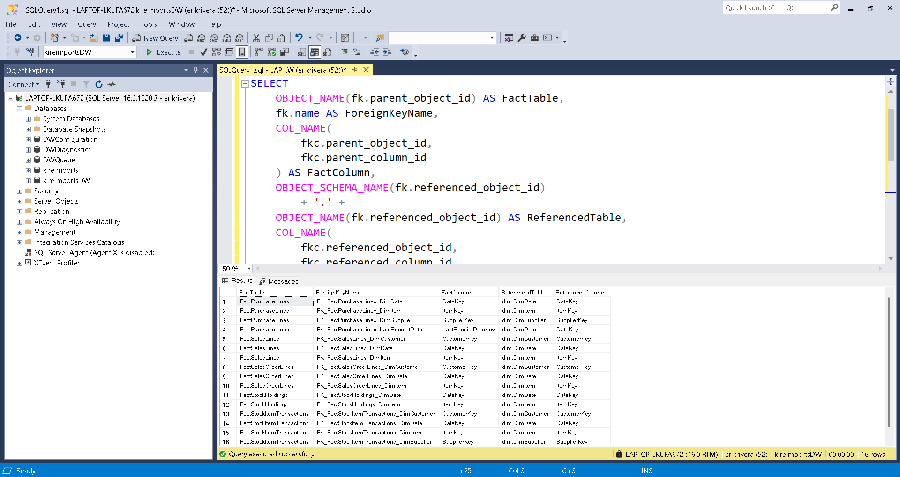

## 4.3.4. Verificación de claves primarias y restricciones de unicidad

```sql

-- =============================================
-- Verificación de claves primarias e índices únicos de tablas de hechos
-- =============================================

SELECT
    t.name AS TableName,
    i.name AS ConstraintName,
    i.is_primary_key AS IsPrimaryKey,
    i.is_unique AS IsUnique
FROM sys.tables t
INNER JOIN sys.indexes i
    ON t.object_id = i.object_id
WHERE t.schema_id = SCHEMA_ID('fact')
  AND i.index_id > 0
  AND (
      i.is_primary_key = 1
      OR i.is_unique_constraint = 1
  )
ORDER BY
    t.name,
    i.name;
GO
```

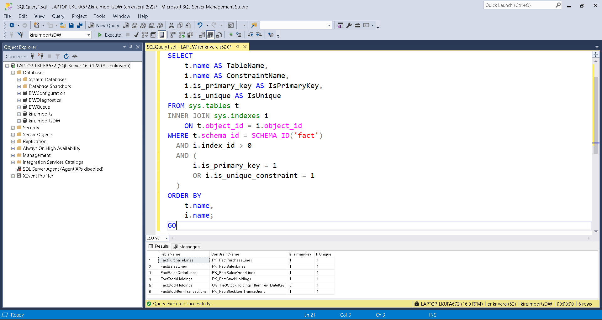


